# GAGARIN NMS

A free base editor for **No Man's Sky**. Build a base in the app, then load it in the game.

Download **[GAGARIN NMS 1.3.0 — Insignia](https://github.com/ThePrecisionTechnician/Gagarin-NMS/releases/tag/v1.3.0)** from [Releases](../../releases).

## Screenshots

Explore the workspace and creation tools. Click any screenshot to view it at full size.

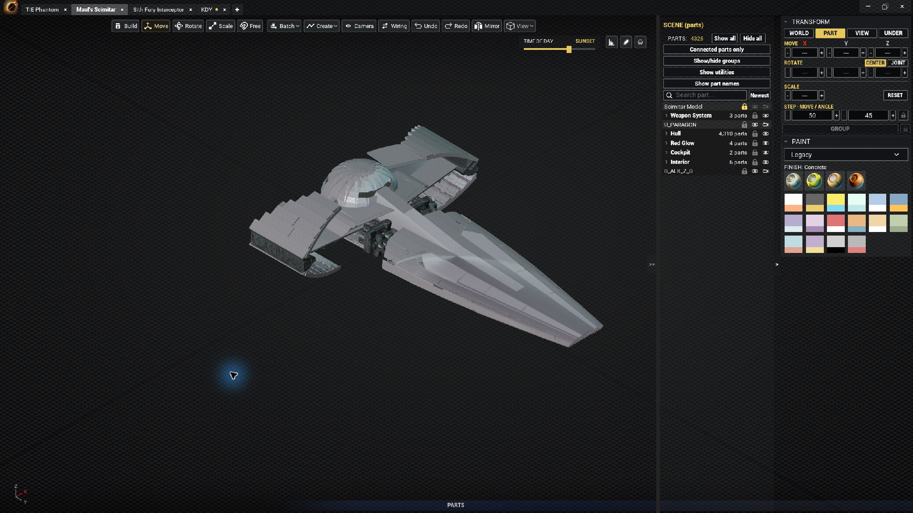

**Main workspace:** build and inspect ships with the scene list, transform controls and paint palette close at hand.

| | |
|---|---|
| 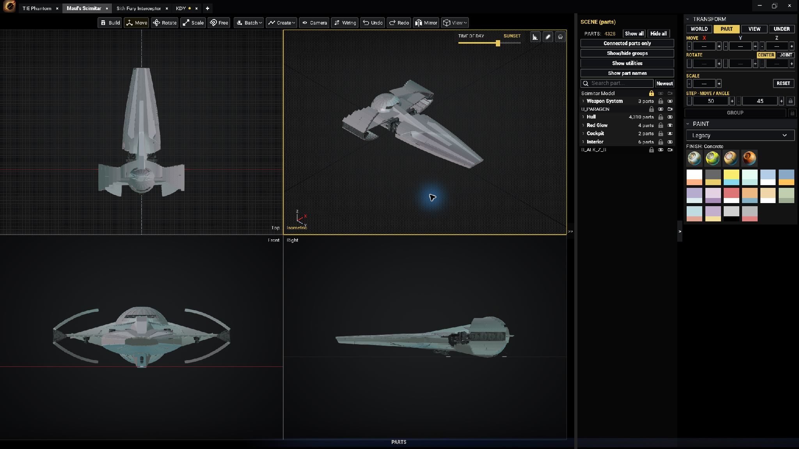 | 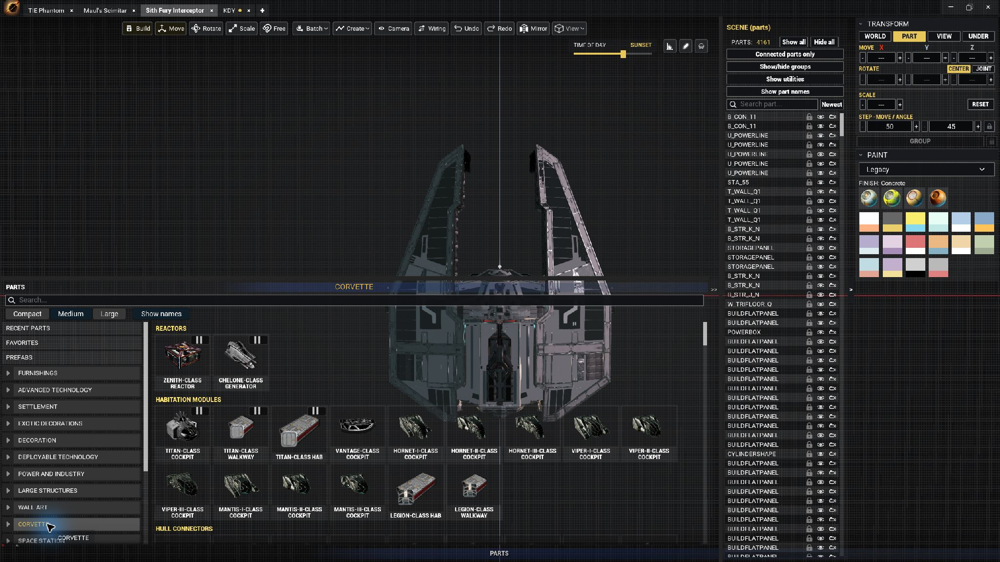 |
| **Quad View:** inspect a build from four fixed viewpoints. | **Parts browser:** browse categories and choose parts visually. |
| 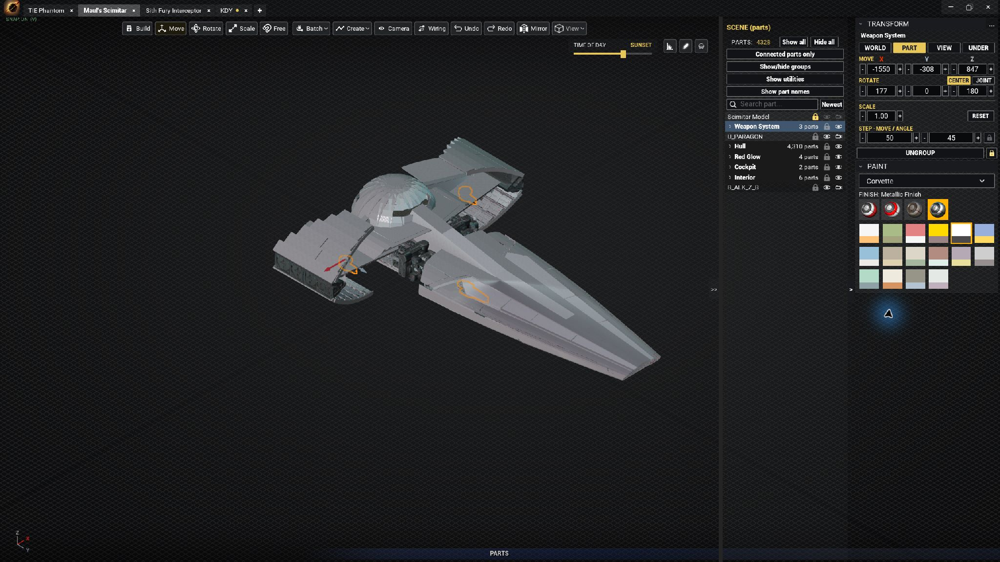 | 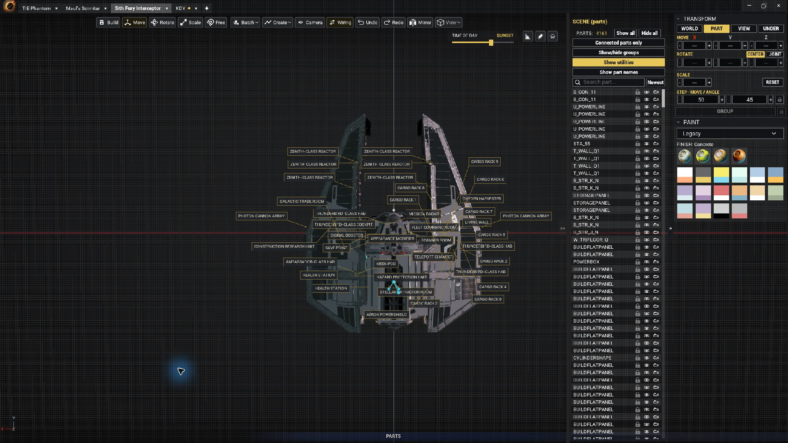 |
| **Transforms and painting:** precise group controls, colours and material finishes. | **Utility finder:** locate functional equipment throughout a build. |
| 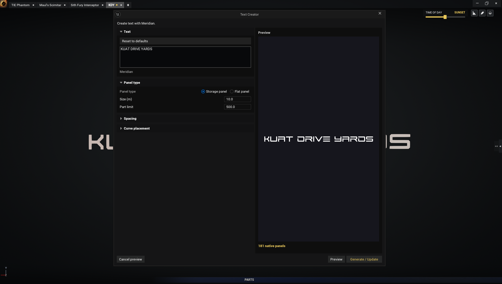 | 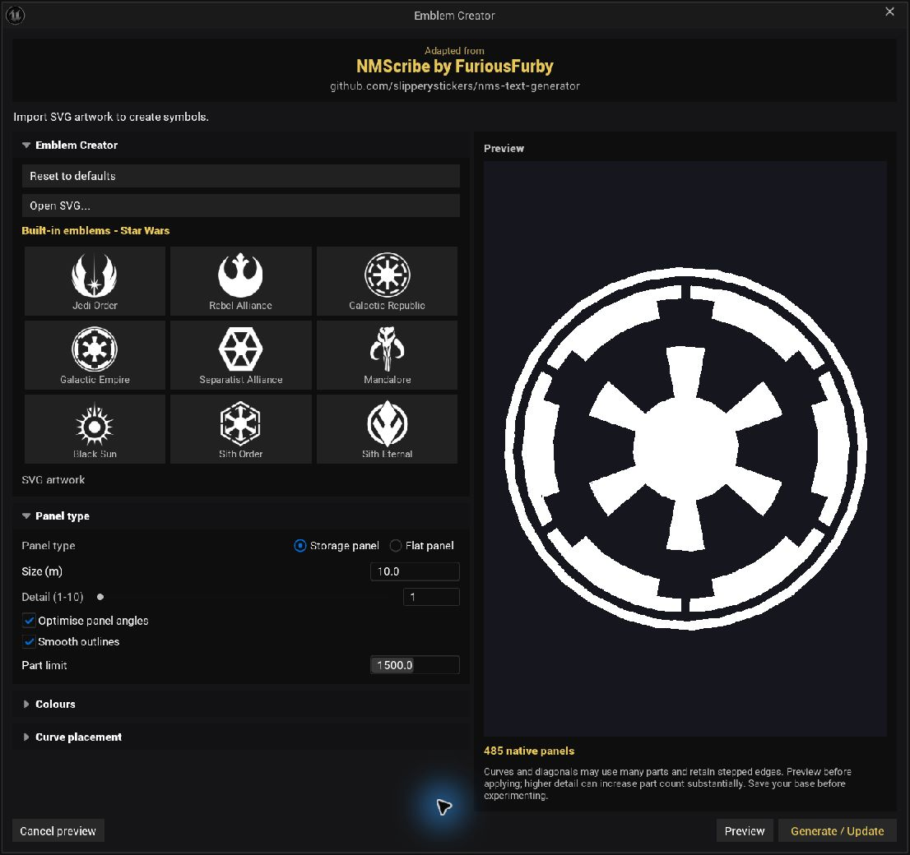 |
| **Text Creator:** preview Meridian lettering built from native panels. | **Emblem Creator:** import SVG artwork or choose from nine built-in emblems. |
| 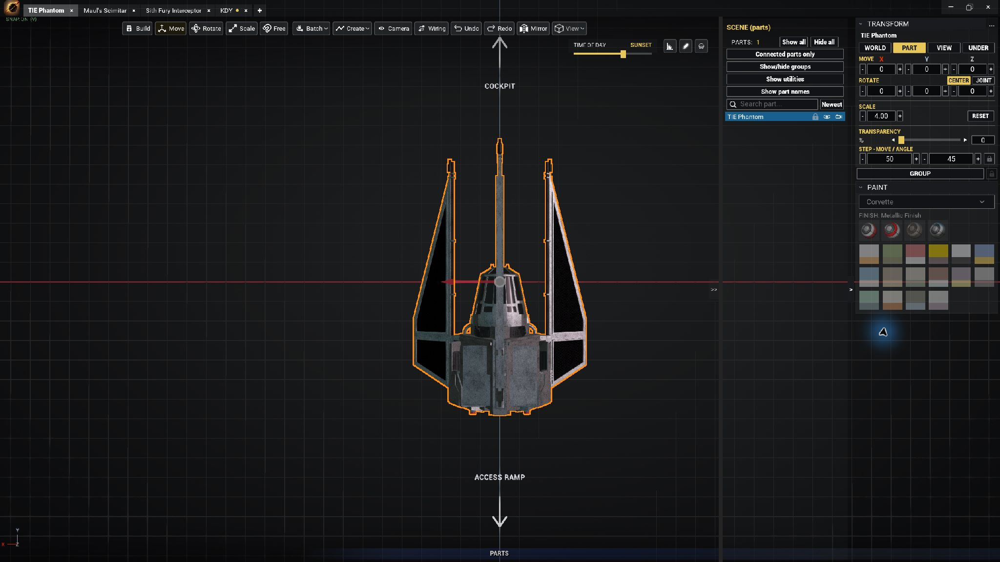 | 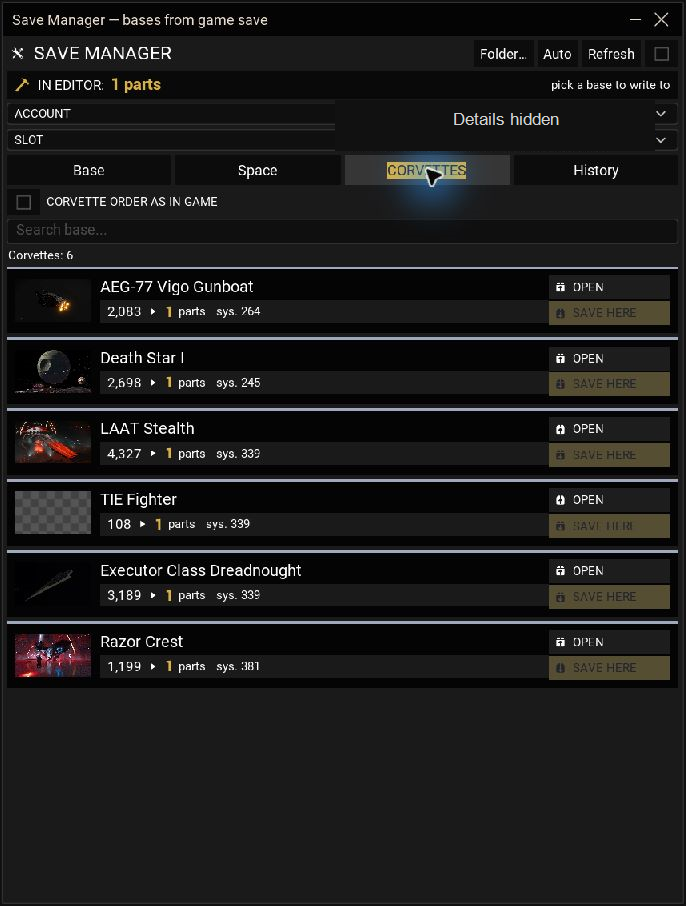 |
| **Model import:** textured reference models with transform and transparency controls. | **Save Manager:** browse and open game saves, then write builds back. Account details are hidden in this screenshot. |
| 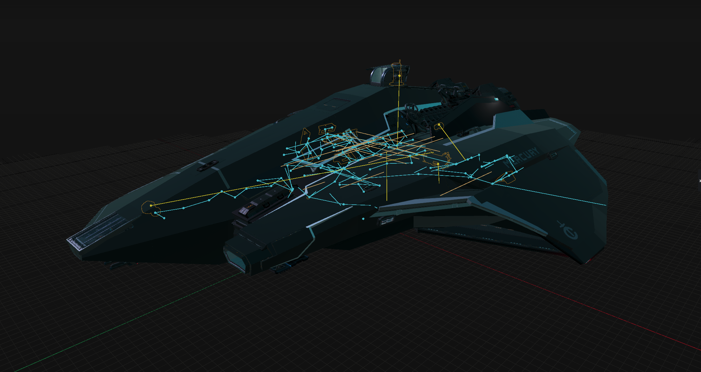 | 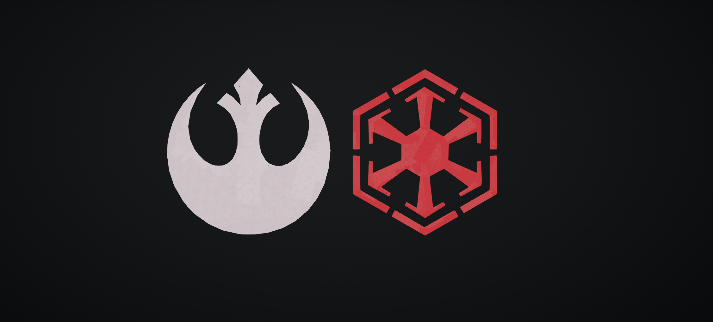 |
| **Wire mode:** inspect electrical and teleport networks through a hull. | **Generated emblems:** Rebel Alliance and Sith Order designs made from native panels. |

## Features

- **Electrical network workspace:** P exposes wiring and connection nodes through the build; connected cables follow moving parts, either endpoint can be edited, and Connected parts only isolates the equipment in a circuit.
- **Corvette and base utility finder:** Show utilities labels cockpits, docking equipment, teleporters, trade terminals and other functional parts with readable names, gold pointers and subtle outlines. Utilities stay visible over Hide all while enabled.
- **Player references:** default race models with grayscale textures, optional holograms and idle playback/pause.
- **Interaction zones:** toggle proximity-switch and tractor-beam activation boundaries.
- **Import organization:** F2 renaming for prefab groups, 3D models and images, with hover highlights and session persistence.
- **Parts catalog:** 1,885 in-game parts with their models, icons, and names in 17 languages, plus search, groups, and favourites.
- **Building tools:** snapping, move/rotate/scale controls, free placement, mirroring, curved placement, and reusable multi-part prefabs.
- **Single-part placement:** pick a normal part and click to place it once; placement ends and selection clears.
- **Scene groups:** name, collapse, sort and show/hide groups; visibility controls also support highlighted parts.
- **Text & Emblem Creator:** generate editable native-panel text or SVG artwork with Storage / Flat panels. Emblem Creator is adapted from [NMScribe by FuriousFurby](https://github.com/slipperystickers/nms-text-generator), with nine built-in emblems, custom SVG import, detail levels 1–10, and a 2,000-part default budget (3,000 maximum). Complex artwork may need simpler geometry or a higher limit.
- **Quad View:** edit in fixed Top, Isometric, Front and Right views with shared selection and changes, middle-mouse panning, wheel zoom, and layout persistence across tabs.
- **Compact workspace:** icon-and-label toolbar, translucent view picker, category-and-grid parts browser, and a full-height scene list beside the transform and paint controls.
- **Painting:** in-game colours and finishes, with an eyedropper and highlights for the selected part’s saved scheme. Controls are disabled for parts that cannot be recoloured.
- **Save editing:** read bases from a No Man's Sky save and write them back.
- **Scene options:** panoramic backgrounds that follow the camera, black, Off-white and White backgrounds, ground coverings, time of day, lighting, and image settings.
- **Base tabs and session restore:** continue work after restarting the app; double-click or right-click tabs to rename bases or ships, with the name reflected in JSON export. Each tab remembers its camera view, and a gold dot marks unsaved changes.
- **GLB model import:** retain separate material colours and base-colour textures across imported model sections.
- **Numeric controls:** hover over numeric − / + controls and scroll to adjust values; right-click transform values to reset them.
- **Keyboard shortcuts:** Z for the parts list; B for plain grey shading; Ctrl+N for a new base, including with the 3D viewport focused; Esc for the menu when idle with no selection; A to focus the origin in an empty scene.
- **In-app guide:** press F1 for the controls and feature instructions, including the recent editing and tab improvements.

## Install

1. Download `GAGARIN_NMS_v1.3.0.zip` from [Releases](../../releases).
2. Extract the archive with 7-Zip or Windows File Explorer.
3. Run `GAGARIN_NMS\\GAGARIN NMS.exe`.

There is no installer and the app does not write to the Windows registry. To uninstall it, delete the extracted folder.

**Requirements:** Windows 10 or 11 (64-bit), a DirectX 12 capable GPU, and about 1.2 GB of disk space for the archive plus extracted app, with additional space for imported-model caches and saved sessions.

### Automatic updates

Fork builds **1.1.1 and later** check this repository for future releases. Automatic checks are enabled by default; saved update preferences are respected.

The mirrored v1.1.0 executable and original developer builds still check the original project's feed. Download and install **1.3.0 manually once** to switch to this fork. Later fork releases can be installed through the included updater.

### Windows warning on first launch

Windows may show “Windows protected your PC” because the app does not have a paid developer signature. Select **More info → Run anyway**. You can verify the download using the SHA-256 value in the release notes.

## No Man's Sky saves

The app can write a completed base directly to your game save. It blocks writes while the game is running, creates a dated backup before each write, and reads the file back to verify it afterward.

Please make your own copy of the save folder before your first edits.

Game saves are stored in:

```
%APPDATA%\\HelloGames\\NMS
```

The app's settings and tabs are stored in:

```
%LOCALAPPDATA%\\NMS_BuilderApp\\Saved
```

## Verify a download

The release notes include the SHA-256 checksum for the archive. In PowerShell, run:

```powershell
Get-FileHash 'GAGARIN_NMS_v1.3.0.zip' -Algorithm SHA256
```

The resulting hash must match the value in the release notes.

## Changelog

### [v1.3.0 — Insignia](https://github.com/ThePrecisionTechnician/Gagarin-NMS/releases/tag/v1.3.0)

- **Emblem Creator**, adapted from NMScribe by FuriousFurby: custom SVG import and nine built-in emblems, thumbnail selection, colour matching, previews, and native Storage / Flat panel generation.
- Detail **1–10**, default **5**; default **2,000-part** budget and **3,000-part** maximum. Emblems generate centred at the ground origin, smooth face upward, without an added background.
- **Quad View:** shared editing across fixed Top, Isometric, Front and Right views; middle-mouse pan, wheel zoom, and persistent layout when switching tabs.
- Refreshed workspace with a slim icon-and-label toolbar, compact translucent View menu, narrower controls, full-height scene list, and improved smaller-screen and ultrawide layouts.
- Parts browser polish, consistent typography, gold part counts, full-width paint swatches, clearer tooltips and custom creator icons. Text Creator defaults to **KUAT DRIVE YARDS**.
- Fixed orange speckled selection fill around imported references. **A / Fit All** ignores U_PARAGON; selecting it and pressing **F** still focuses it.
- Clearer **Open / save bases in game saves** menu and updated instructions and translations.

**Thank you, FuriousFurby!** For allowing us to bring [NMScribe](https://github.com/slipperystickers/nms-text-generator) into GAGARIN's Emblem Creator.

### [v1.2.9 — Mirroring & Compatibility](https://github.com/ThePrecisionTechnician/Gagarin-NMS/releases/tag/v1.2.9)

- Added Microsoft Store, Xbox app / PC Game Pass and GOG installation discovery, modern Xbox PC WGS save editing, and GOG save discovery. Live storefront tester acceptance remains pending; see the release notes for details.
- Improved low-memory loading through idle texture-cache reclamation and refreshed budget checks, while retaining the critical-memory guard.
- Clearer **Mirror shape** and **Readable copy** modes, readable panel-text mirroring, and corrected wings, turrets, sofas, corridors, hull variants and S_MACHINE0 orientation.
- Added standard **Ctrl+X / Ctrl+V** cut and paste with Undo/Redo and locked-part protection.
- Disabled Paint for eight fixed-colour decorations; mixed selections still paint supported parts. Updated the guide and all 17 translations.

### [v1.2.8 — Forsaken Revision](https://github.com/ThePrecisionTechnician/Gagarin-NMS/releases/tag/v1.2.8)

- Front, Rear, Left, Right, Top, Bottom and Isometric camera presets with framing controls; fixed Top-view clipping during zoom.
- Corrected cockpit mirror placement and R-wing counterpart pairing.
- Improved parts navigation with localized categories, adjustable tiles, optional names and a resizable panel; reorganized BASE, VIEW, LIGHT and GENERAL settings.
- Added **Ctrl+R** to reset selected transforms, clearer selection outlines, refined grids and doubled visible grid range.
- New studio and hangar backgrounds; corrected grayscale GLB textures and material transparency, plus catalog polish.

### [v1.2.7 — Forsaken Update](https://github.com/ThePrecisionTechnician/Gagarin-NMS/releases/tag/v1.2.7)

- Compatibility with No Man's Sky Forsaken and new building parts.
- Consolidated Corvette variant families and improved tractor-beam placement in the catalog.
- Part and group locking, newest-first scene ordering and pinned imported models.
- Improved precision controls, file shortcuts, new tabs and F1 instructions.
- Dark file dialogs, GLB/OBJ/STL file selection, scale-preserving player-reference Reset and clearer selection outlines.

### [v1.2.6 — Painting, Model Transparency & Wiring Fixes](https://github.com/ThePrecisionTechnician/Gagarin-NMS/releases/tag/v1.2.6)

- Restored color and finish controls for every part in the **Space Station** category, including annexe decorations.
- Improved **imported-model transparency** across material slots while preserving textures and colors. Selection no longer changes the model's transparency, and opacity is restored when reopening a build.
- Brighter **electrical and teleport connection orbs**, visible through surrounding parts in wire mode, with dimmer glow when obscured.
- Added **Power** and **Teleport** snap feedback beside connection targets, plus brief confirmation after connecting.
- Hidden parts now hide their associated effects and lights in **Connected parts only** mode.
- Extended origin axes for very large builds, with consistent visible line widths.
- Larger, clearer measurement labels follow the ruler line and remain upright, with a dark background for readability.

### [v1.2.5 — Clearer Axes & Backgrounds](https://github.com/ThePrecisionTechnician/Gagarin-NMS/releases/tag/v1.2.5)

- New **Off-white** and **White** backgrounds.
- Muted gray-blue Y and medium-gray Z gizmo axes, with matching bottom-left orientation colors.
- Thicker ground axes in **G's axes-only mode**.
- Move arrows are 20% thinner, with unchanged click tolerance; gizmo handles have 20% transparency.
- Refreshed screenshot gallery showing utilities, wiring overlays and a Resurgent Class Star Destroyer GLB model.

### [v1.2.4 - Clearer Wiring Highlights](https://github.com/ThePrecisionTechnician/Gagarin-NMS/releases/tag/v1.2.4)

- Connected electrical and teleport equipment gains a gold outline in **P / wire mode**, visible through surrounding parts at 50% of the main selection highlight strength.
- Fixed connected outlines staying visible with P off. Wire-mode outlines now follow P directly; hover and selection remain stronger.
- **Show utilities** excludes Sphere Creator and Light Floor to reduce label and outline clutter. Its toggle remains independent of P.

### [v1.2.3 — Electrical Networks & Utilities](https://github.com/ThePrecisionTechnician/Gagarin-NMS/releases/tag/v1.2.3)

**Electrical network overhaul**

- Inspect the entire network with **P**, including dimmer cable sections and nodes behind parts. Hide all leaves wiring under its independent P control.
- Electrical and teleport connections follow their sockets when parts move, rotate or scale. Click either cable endpoint to edit that end with its ring or Move gizmo.
- Translucent cyan electrical cables and yellow teleport cables have matching glowing nodes, moving pulses and full-length hover feedback. These are visual guides, not simulated power.
- **Connected parts only** isolates electrically or teleport-linked parts, including unpowered circuits, and restores previous visibility when switched off.

**Corvette and base utilities**

- **Show utilities** pinpoints cockpits, landing/docking equipment, teleporters, trade terminals, signal boosters and other functional parts with localized names, gold leader lines and thin gold outlines.
- Labels face the camera and remain readable at different part scales and zoom levels. Overlap avoidance prioritizes nearby and hovered utilities in crowded views.
- Utility outlines are half as strong as hover outlines. Utilities remain visible over Hide all and Connected parts only while enabled; switching off restores visibility choices.

**Also improved:** selected paint feedback and disabled controls for non-recolourable parts; G cycles grid+axes / axes only / off; grouped-part visibility toggle; short-range teleporter selection; smaller Move-gizmo centre; borderless fullscreen on every startup; concise F1 instructions.

### [v1.2.2](https://github.com/ThePrecisionTechnician/Gagarin-NMS/releases/tag/v1.2.2)

- Toggle interaction zones for proximity switches and tractor beams, using shapes, ranges and orientations from game data.
- Default race references with textured grayscale appearance, optional cyan holograms, and idle animation On by default with playback/pause controls.
- F2 renaming for prefab groups, imported 3D models and image imports, with Undo/Redo and session restore.
- Fixed imported-model and image hover highlights; removed the redundant search field from the rename menu.
- In-game save names in the save selector, borderless fullscreen by default on new installations, English F8 diagnostics, and updated F1 instructions.
- Custom characters from saves remain hidden from the public UI. General part animations and powered-hover engine effects remain in development.

### [v1.2.1](https://github.com/ThePrecisionTechnician/Gagarin-NMS/releases/tag/v1.2.1)

- Player references: Anomaly, Korvax, Vy’keen, Traveller and Autophage.
- Independent hologram/textured appearance, gizmo movement and rotation, Ctrl stepping, Scene selection and hover outlines.
- References are session-only guides, excluded from base exports and part counts. Custom characters from saves are not included in this version.

### [v1.2.0](https://github.com/ThePrecisionTechnician/Gagarin-NMS/releases/tag/v1.2.0)

- Reviewed Meridian alphabet A–Z and digits 0–9.
- Separate Text Creator and Symbol Creator, sizes in metres and simpler text controls.
- Improved SVG declarations and artwork visibility at a distance and after changing tabs.
- Scene Show all / Hide all and duplication confirmation. Version 1.1.10 was superseded by 1.2.0.

### [v1.1.9](https://github.com/ThePrecisionTechnician/Gagarin-NMS/releases/tag/v1.1.9)

- Mouse thumb-button camera panning and Ctrl+A for visible parts.
- Sidebar simplification, standalone window controls and New Base placement after the last tab.
- Creator controls and Horizon V improvements; updated F1 guide.

### [v1.1.8](https://github.com/ThePrecisionTechnician/Gagarin-NMS/releases/tag/v1.1.8)

- Fixed F2 group renaming when the viewport has keyboard focus.

### [v1.1.7](https://github.com/ThePrecisionTechnician/Gagarin-NMS/releases/tag/v1.1.7)

- Copy/paste position, rotation and scale; F2 group renaming.
- Menu dismissal, tooltip improvements and a larger Save Manager.
- Compact creator controls and improved straight-stroke panel fitting.

### [v1.1.6](https://github.com/ThePrecisionTechnician/Gagarin-NMS/releases/tag/v1.1.6)

- Named, collapsible Scene groups with visibility controls and alphabetical sorting.
- Compact interface, smaller tooltips and toolbar, and independently collapsible sidebar sections.
- Precision scaling: Ctrl for 0.01 steps and Ctrl+Shift for 0.001, with a minimum scale of 0.001.
- **Text & Symbol Creator (Beta)** with Storage / Flat panel selection and remembered settings. Curved and diagonal fitting is still experimental and can use excessive parts; check the preview and save before experimenting.
- See the release notes for verification details and the unresolved group-scaling report.


### [v1.1.5](https://github.com/ThePrecisionTechnician/Gagarin-NMS/releases/tag/v1.1.5)

- **Swapped B / Z shortcuts:** **Z** opens or closes the parts list; **B** toggles the plain grey shading view. **Ctrl+Z** remains Undo.
- **Single-part placement:** choosing a normal part and clicking places one part, exits placement mode, and clears its selection. Esc still cancels before placement.
- **Matching instructions:** F1 first steps, placement instructions, shortcut labels, tooltips, and the shading badge reflect the changes across all 17 supported languages.

### [v1.1.4](https://github.com/ThePrecisionTechnician/Gagarin-NMS/releases/tag/v1.1.4)

- **Ctrl+N anywhere in the builder:** New Base now works with the 3D building area focused, as well as the tabs and interface. Existing builds remain open; typing and modal-dialog protections are retained.
- **Updated F1 instructions:** added the recent wheel controls, right-click resets, tab renaming, unsaved indicator, remembered camera views, empty-scene focus, mirror defaults, background 12, and idle Esc menu behavior. Uses the existing guide layout and all 17 supported languages.
- **Maintainer links:** the in-builder Support the author and Discord buttons now point to ThePrecisionTechnician’s Patreon and Discord profile, matching this repository.

### [v1.1.3](https://github.com/ThePrecisionTechnician/Gagarin-NMS/releases/tag/v1.1.3)

- **Storage Panel mirroring:** corrected the offset origin so STORAGEPANEL copies line up across the selected axis, including rotated panels. Existing placed parts are not moved automatically.
- **Mirror plane:** opens at **0 cm** and resets to zero when changing axes; custom offsets and On Part remain available.
- **Mouse-wheel controls:** hover over numeric − / + controls to adjust transforms, movement/angle steps, the mirror plane, and supported settings. Removed distracting numeric hover popups.
- **Quick resets:** right-click individual transform values for position/rotation 0 or scale 1; reset the mirror plane to 0 cm, steps to their defaults, and menu sliders to their declared defaults.
- **Keyboard shortcuts:** **Ctrl+N** creates a new base; **Esc** opens the main menu when no parts are selected and no operation is active; **A** focuses the origin when the scene is empty.
- **Tab renaming:** double-click a tab title to rename it, alongside the existing right-click menu. Names continue to appear in exported JSON.
- **Unsaved indicator:** a gold dot marks changes since the last explicit save/export. Automatic session backups do not clear it; undoing to the saved state clears it within the current session.
- **Remembered views:** each tab retains its camera position and orientation when switching tabs and across normal restarts.

### [v1.1.2](https://github.com/ThePrecisionTechnician/Gagarin-NMS/releases/tag/v1.1.2)

- **Surrounding backgrounds:** the panorama now follows the camera with a 1,000 km radius, keeping the view enclosed when moving or zooming far from a build.
- **Black / Abyss:** added a fully black background as option **12** in Settings → View → Change background. Model lighting and ground controls remain independent.
- **Saved choices:** existing backgrounds retain their numbers and saved selections.

### [v1.1.1](https://github.com/ThePrecisionTechnician/Gagarin-NMS/releases/tag/v1.1.1)

- **Sharper rendering:** start at full rendering resolution, including when saved window settings already match.
- **Mouse-wheel scaling:** hover over the Scale number and scroll up or down to resize selected parts.
- **Rename tabs:** right-click a tab to rename a base or ship. Names persist across sessions and appear in exported JSON, with Undo/Redo support. Removed the unused search field from the tab menu.
- **Game JSON export:** consistent field order and four-space indentation, exact numeric GalacticAddress values, and preservation of unknown metadata and numeric precision.
- **GLB materials:** preserve separate base-colour textures and material colours through import, simplification, caching, and session restore. Also retain scalar roughness/metallic values and opaque double-sided material settings.
- **Automatic updates:** this build uses this fork's release feed. Update checks are enabled by default and respect saved preferences.

**Upgrading from the original app or v1.1.0?** Install v1.1.1 manually once to switch to this fork's update feed. Future fork releases can use the included updater.

### [v1.1.0](https://github.com/ThePrecisionTechnician/Gagarin-NMS/releases/tag/v1.1.0)

- Initial public mirror of the original developer's build. This executable retains the original project's update feed.

## Support

If something goes wrong, report what you did, what you expected, and what happened. Include your No Man's Sky version, GPU model, and the base file involved. Contact and support links are available in the app's main menu.

- Discord: [ThePrecisionTechnician](https://discord.com/users/262494560545013762)
- GitHub: [ThePrecisionTechnician](https://github.com/ThePrecisionTechnician)

**Support the project:** [Patreon](https://www.patreon.com/cw/ThePrecisionTechnician)

---

GAGARIN NMS was created by **autoeme** and was passed on and is now maintained by **ThePrecisionTechnician**. Part models, icons, and names belong to Hello Games; the app displays assets already present in your copy of the game.
