# GAGARIN NMS

A free base editor for **No Man's Sky**. Build a base in the app, then load it in the game.

Download **[GAGARIN NMS 1.5.4 — Corvette Interiors](https://github.com/ThePrecisionTechnician/Gagarin-NMS/releases/tag/v1.5.4)** from [Releases](../../releases).

## GAGARIN Launcher 1.0.3

**GAGARIN a KDY Production**

**[Download the launcher EXE](https://github.com/ThePrecisionTechnician/Gagarin-NMS/releases/download/launcher-v1.0.3/GAGARIN_Launcher_v1.0.3.exe)** · [Release notes and checksums](https://github.com/ThePrecisionTechnician/Gagarin-NMS/releases/tag/launcher-v1.0.3)

Choose any combination of **Standard Builder**, **Compact 1K Standalone**, **Full Resolution Standalone**, and **[Gagarin-Titov](https://github.com/ThePrecisionTechnician/Gagarin-Titov)**. The launcher downloads, verifies and extracts numbered archive parts automatically, with separate Builder folders and pause/resume, update, repair and launch controls. Every product row links to its repository for more details. Nothing is checked by default. Catalog refresh and language changes preserve your current choices, including an empty selection. The dark **Language** menu offers all **17 Gagarin NMS languages**, remembers your choice and updates controls, ordinary status messages and F1 / Instructions immediately.

The launcher has a dark interface and the Imperial icon from the existing Gagarin artwork. Its top-right **Support the author**, **Discord / Contact me**, and **Kuat Drive Yards Discord** buttons match Builder’s styling and use the same destinations. It automatically checks for and downloads its own updates; choose **Restart to update** when ready. The update helper verifies the replacement and restores the previous EXE if startup fails. Builder editions and Titov retain their separate updaters.

Windows 10/11 x64 with .NET Framework 4.8. Keep the launcher EXE in a writable folder. It is a small download; product/asset downloads are separate. Standard and Titov require the game; Titov also requires a reviewed compatible game build. **No Man's Sky Installation Not Required** for either standalone edition. Press **F1** for instructions.

## Choose an edition

| Edition | No Man's Sky installation | Download |
|---|---|---|
| [Standard 1.5.4](https://github.com/ThePrecisionTechnician/Gagarin-NMS/releases/tag/v1.5.4) | Required for game assets | About 565 MB, one ZIP |
| [Compact 1K Standalone 1.5.4](https://github.com/ThePrecisionTechnician/Gagarin-NMS/releases/tag/compact-v1.5.4) | Not required | About 5.85 GB, three parts |
| [Full Resolution Standalone 1.5.4](https://github.com/ThePrecisionTechnician/Gagarin-NMS/releases/tag/fullres-v1.5.4) | Not required | About 15.42 GB, eight parts |

**No Man's Sky Installation Not Required** for either standalone edition.

Compact Standalone retains all 117,267 resources from the full standalone edition. Eligible textures use original authored mip levels up to 1K; geometry and material logic are unchanged. Higher-resolution detail requires the full-resolution assets.

For Compact Standalone, download **all three parts** into one folder:
[Part 1](https://github.com/ThePrecisionTechnician/Gagarin-NMS/releases/download/compact-v1.5.4/GAGARIN_NMS_Compact1K_v1.5.4.zip.001),
[Part 2](https://github.com/ThePrecisionTechnician/Gagarin-NMS/releases/download/compact-v1.5.4/GAGARIN_NMS_Compact1K_v1.5.4.zip.002),
[Part 3](https://github.com/ThePrecisionTechnician/Gagarin-NMS/releases/download/compact-v1.5.4/GAGARIN_NMS_Compact1K_v1.5.4.zip.003).
Open/extract **Part 1 (.001)** with 7-Zip or WinRAR; it reads the other parts automatically. Run `GAGARIN_NMS/GAGARIN NMS.exe`. Do not extract each part separately.

Compact uses its own automatic update feed. Routine updates download the application only, verify the installed assets and reader compatibility, and retain the asset pack. Changed assets require a matching standalone download. The application-only CompactUpdate ZIP is not a complete first installation. Older compact builds with updates disabled need the new client installed manually once.

### Full Resolution Standalone

Includes all **117,267 assets at their original texture resolution**. Download **all eight parts** into one folder:
[Part 1](https://github.com/ThePrecisionTechnician/Gagarin-NMS/releases/download/fullres-v1.5.4/GAGARIN_NMS_FullResolution_v1.5.4.zip.001),
[Part 2](https://github.com/ThePrecisionTechnician/Gagarin-NMS/releases/download/fullres-v1.5.4/GAGARIN_NMS_FullResolution_v1.5.4.zip.002),
[Part 3](https://github.com/ThePrecisionTechnician/Gagarin-NMS/releases/download/fullres-v1.5.4/GAGARIN_NMS_FullResolution_v1.5.4.zip.003),
[Part 4](https://github.com/ThePrecisionTechnician/Gagarin-NMS/releases/download/fullres-v1.5.4/GAGARIN_NMS_FullResolution_v1.5.4.zip.004),
[Part 5](https://github.com/ThePrecisionTechnician/Gagarin-NMS/releases/download/fullres-v1.5.4/GAGARIN_NMS_FullResolution_v1.5.4.zip.005),
[Part 6](https://github.com/ThePrecisionTechnician/Gagarin-NMS/releases/download/fullres-v1.5.4/GAGARIN_NMS_FullResolution_v1.5.4.zip.006),
[Part 7](https://github.com/ThePrecisionTechnician/Gagarin-NMS/releases/download/fullres-v1.5.4/GAGARIN_NMS_FullResolution_v1.5.4.zip.007),
[Part 8](https://github.com/ThePrecisionTechnician/Gagarin-NMS/releases/download/fullres-v1.5.4/GAGARIN_NMS_FullResolution_v1.5.4.zip.008).
Open/extract **Part 1 (.001)** with 7-Zip or WinRAR; every part is required. Run `GAGARIN_NMS/GAGARIN NMS.exe`. Do not extract each part separately.

[Installation instructions](https://github.com/ThePrecisionTechnician/Gagarin-NMS/releases/download/fullres-v1.5.4/READ_ME_FIRST.txt) · [SHA-256 checksums](https://github.com/ThePrecisionTechnician/Gagarin-NMS/releases/download/fullres-v1.5.4/SHA256SUMS.txt)

Full Resolution has its own automatic update feed and edition checks. Compatible routine app updates are about **565 MB** and retain and verify the original-resolution pack. Leave free space for a temporary copy of the pack; staging and verification can take several minutes. Different assets or an incompatible reader require a matching complete download. The FullResolutionUpdate ZIP is app-only and cannot be used for a first installation. Older full-resolution builds with updates disabled need this client installed manually once.

## Screenshots

Explore the workspace and creation tools. Click any screenshot to view it at full size.

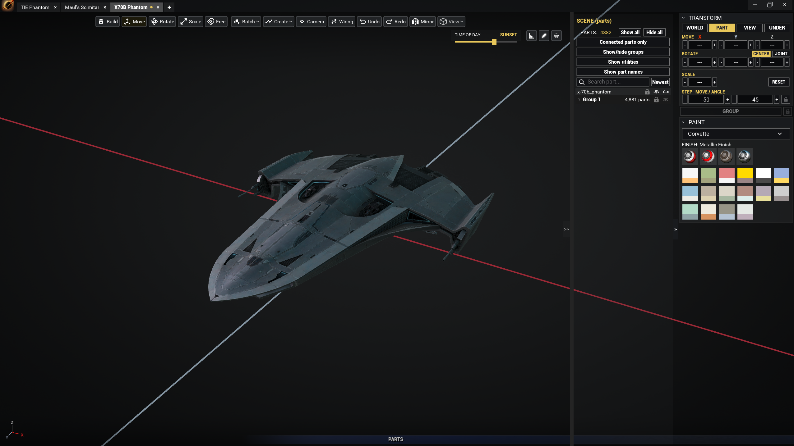

**Main workspace:** build and inspect ships with the scene list, transform controls and paint palette close at hand.

| | |
|---|---|
| 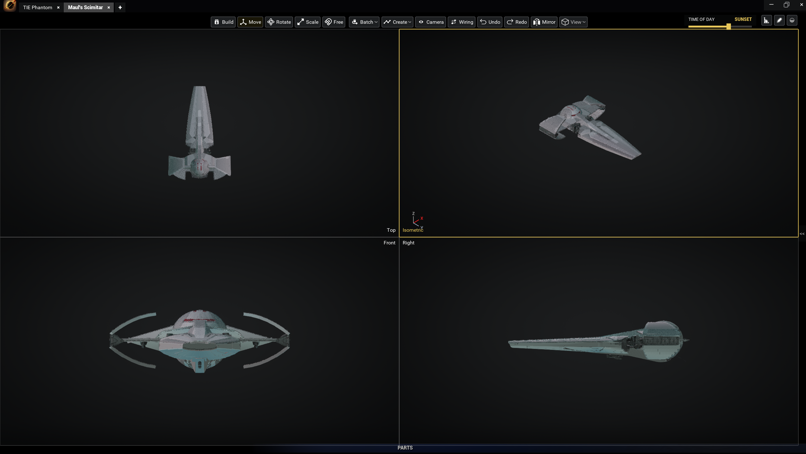 | 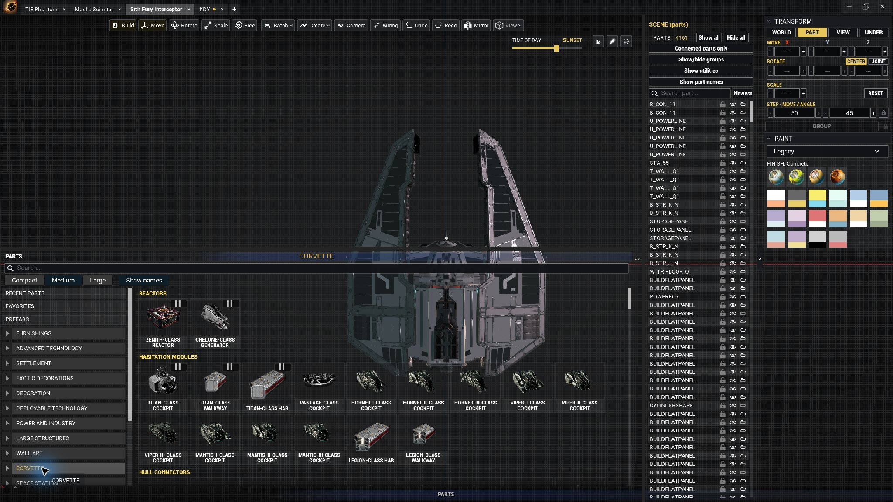 |
| **Quad View:** inspect a build from four fixed viewpoints. | **Parts browser:** browse categories and choose parts visually. |
| 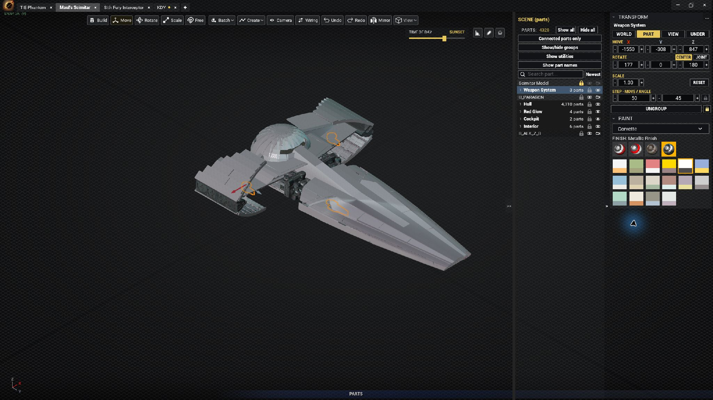 | 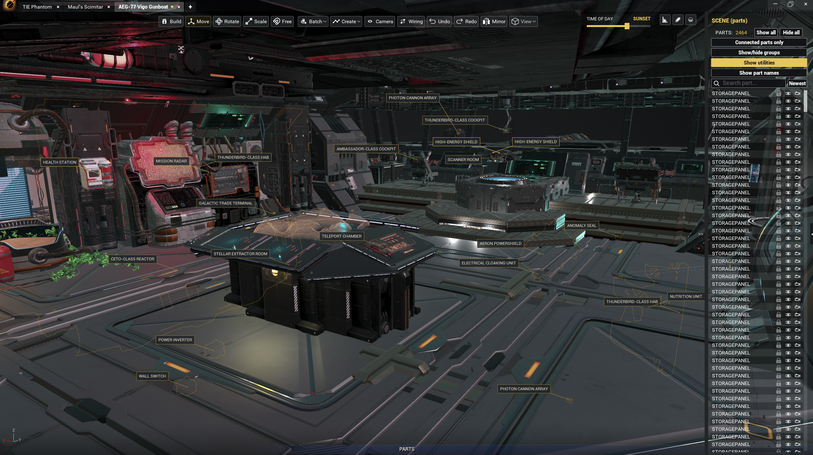 |
| **Transforms and painting:** precise group controls, colours and material finishes. | **Utility finder:** locate functional equipment throughout a build. |
| 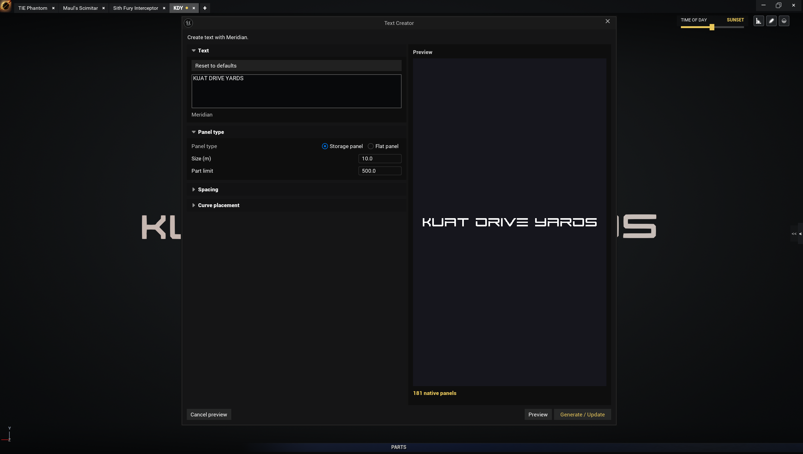 | 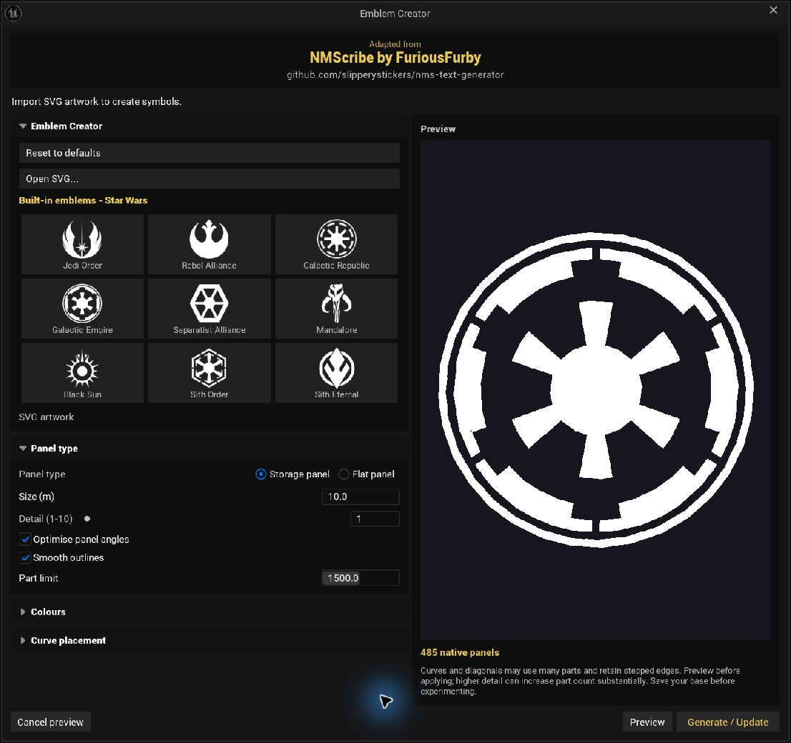 |
| **Text Creator:** preview Meridian lettering built from native panels. | **Emblem Creator:** import SVG artwork or choose from collapsible Star Wars and NMS Factions emblem collections. |
| 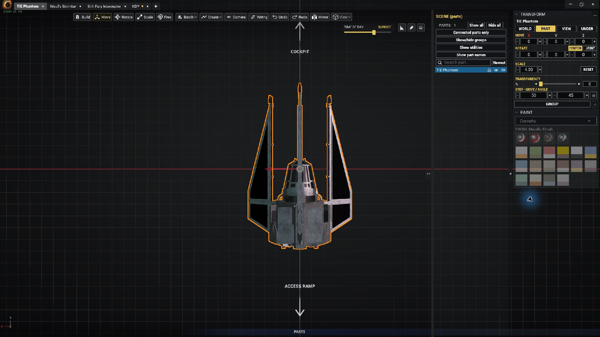 | 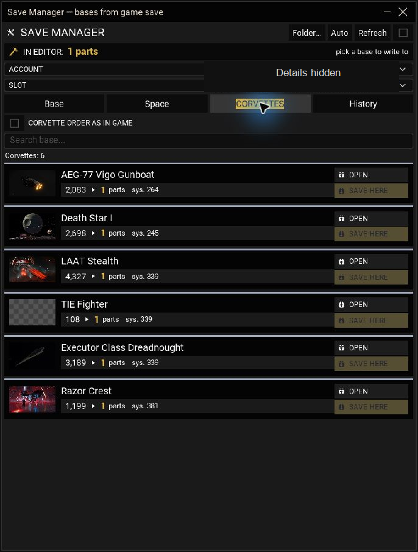 |
| **Model import:** textured reference models with transform and transparency controls. | **Save Manager:** browse and open game saves, then write builds back. Account details are hidden in this screenshot. |
| 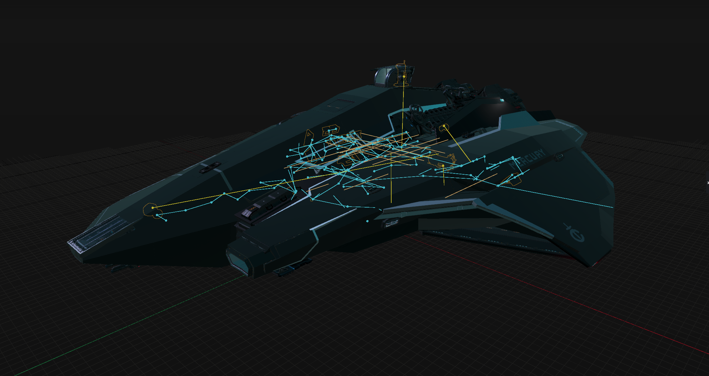 | 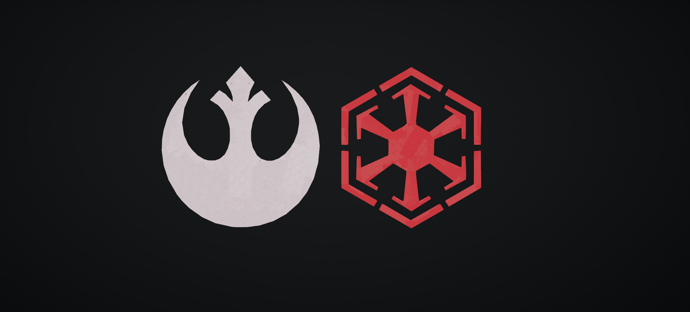 |
| **Wire mode:** inspect electrical and teleport networks through a hull. | **Generated emblems:** Rebel Alliance and Sith Order designs made from native panels. |

| | |
|---|---|
| 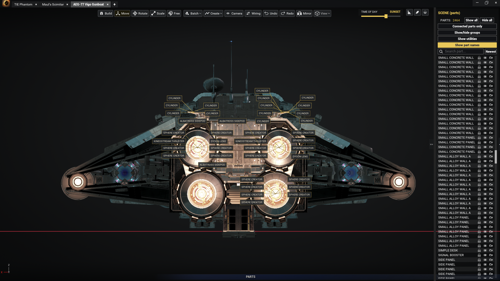 | 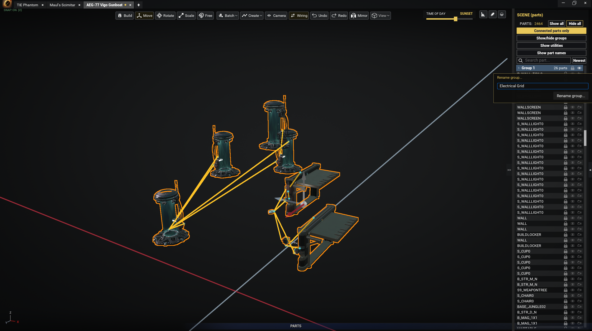 |
| **Show part names:** identify components directly in the viewport with readable labels, and display part names in the scene list. | **Electrical grid isolation:** use Connected parts only to isolate connected equipment and inspect its wiring. |

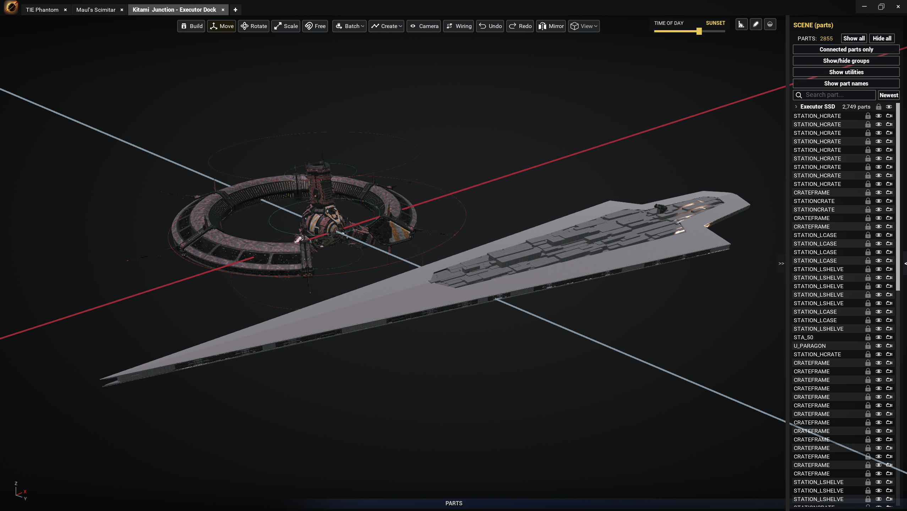

**Space-station rendering:** view station geometry alongside your build to check scale and placement.

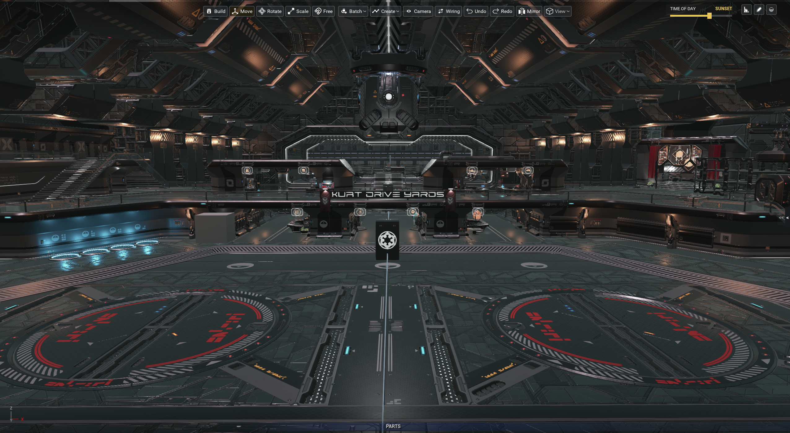

**Space-station interiors:** inspect your base inside the rendered station, with interior geometry, materials and lighting visible alongside your custom build.

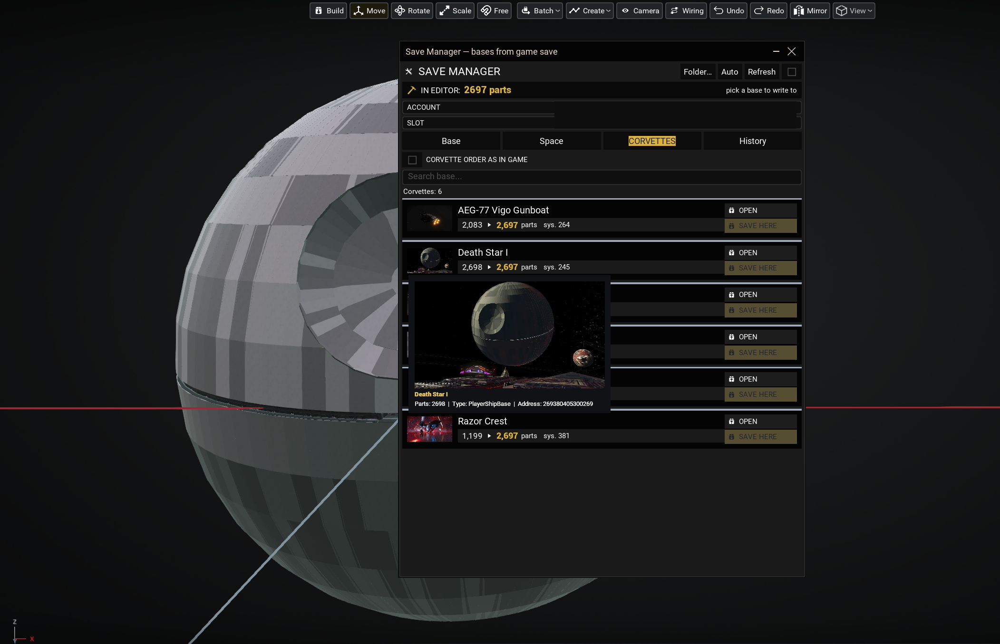

**Custom base and ship thumbnails:** recognize saved builds at a glance, with enlarged previews on hover. Account and save-slot details are hidden in this screenshot.

## Features

- **Large 3D references:** a 50-million-triangle default and 3 GiB file cap, import progress/ETA and improved material handling. Available RAM/VRAM still determine practical model size.
- **Shape creation:** five sphere methods, editable grouped generations, saved presets, Part size controls and whole-preview painting.
- **Precision controls:** group-centred gizmos, independent transform resets, Ground/Origin placement and exact world-axis dimensions. C cycles cameras, X toggles snapping and V toggles Measure.
- **Electrical network workspace:** P exposes wiring and connection nodes through the build; connected cables follow moving parts, either endpoint can be edited, and Connected parts only isolates the equipment in a circuit.
- **Corvette and base utility finder:** Show utilities labels cockpits, docking equipment, teleporters, trade terminals and other functional parts with readable names, gold pointers and subtle outlines. Utilities stay visible over Hide all while enabled.
- **Player references:** textured race models by default, with transform controls, optional holograms and idle playback/pause.
- **Interaction zones:** toggle proximity-switch and tractor-beam activation boundaries.
- **Import organization:** F2 renaming for prefab groups, 3D models and images, with hover highlights and session persistence.
- **Parts catalog:** 1,885 in-game parts with their models, icons, and names in 17 languages, plus search, groups, and favourites.
- **Corvette interiors:** styled module variants, cached thumbnails and a view-only ceiling cutaway for editing inside habs and walkways. Native tiny-hab assemblies retain their appearance and move together.
- **Building tools:** snapping, move/rotate/scale controls, free placement, mirroring, curved placement, and reusable multi-part prefabs.
- **Single-part placement:** pick a part or variant and click to place it once; the new part or assembly remains selected for immediate movement.
- **Scene groups:** name, collapse, sort and show/hide groups; visibility controls also support highlighted parts.
- **Text & Emblem Creator:** generate editable native-panel text or SVG artwork with Storage / Flat panels. Emblem Creator is adapted from [NMScribe by FuriousFurby](https://github.com/slipperystickers/nms-text-generator), with Star Wars and NMS Factions collections, custom SVG import, detail levels 1–10, and a 2,000-part default budget (3,000 maximum). Complex artwork may need simpler geometry or a higher limit.
- **Quad View:** edit in fixed Top, Isometric, Front and Right views with shared selection and changes, middle-mouse panning, wheel zoom, and independent pane zoom and framing saved per tab.
- **Compact workspace:** icon-and-label toolbar, translucent view picker, category-and-grid parts browser, and a full-height scene list beside the transform and paint controls.
- **Painting:** in-game colours and finishes, with an eyedropper and highlights for the selected part’s saved scheme. Controls are disabled for parts that cannot be recoloured.
- **Save editing:** read bases and corvettes from game saves, create fresh C-class starters, safely delete corvettes, and use attached parts tools for manual optimization, duplicate cleanup and reordering with backups.
- **Scene options:** panoramic backgrounds that follow the camera, black, Off-white and White backgrounds, ground coverings, time of day, lighting, and image settings.
- **Base tabs and session restore:** continue work after restarting the app; double-click or right-click tabs to rename bases or ships, with the name reflected in JSON export. Each tab remembers its camera view, and a gold dot marks unsaved changes.
- **GLB model import:** retain separate material colours and base-colour textures across imported model sections.
- **Numeric controls:** hover over numeric − / + controls and scroll to adjust values; right-click transform values to reset them.
- **Keyboard shortcuts:** Z for the parts list; B for plain grey shading; Ctrl+N for a new base, including with the 3D viewport focused; Esc for the menu when idle with no selection; A to focus the origin in an empty scene.
- **In-app guide:** press F1 for the controls and feature instructions, including the recent editing and tab improvements.

## Install

1. For the Standard edition, download `GAGARIN_NMS_v1.5.4.zip` from [Releases](../../releases). For either standalone edition, download every numbered part using its instructions above.
2. Extract the Standard ZIP with 7-Zip or Windows File Explorer. Use 7-Zip or WinRAR for either standalone multipart archive.
3. Run `GAGARIN_NMS\\GAGARIN NMS.exe`.

There is no installer and the app does not write to the Windows registry. To uninstall it, delete the extracted folder.

**Requirements:** Windows 10 or 11 (64-bit) and a DirectX 12 capable GPU. Standard needs an installed copy of No Man's Sky for game assets and about 1.2 GB for the download plus extracted app. Neither standalone edition requires a game installation. Allow about 12 GB for the Compact download plus extracted app, or about 31 GB for Full Resolution. Allow additional space for caches and sessions, about 8 GB free for staging compact app updates, and space for a temporary copy of the full asset pack during Full Resolution updates.

### Automatic updates

Standard fork builds **1.1.1 and later** check this repository for future standard releases. Compact 1K and Full Resolution each use a dedicated feed and reject updates from other editions. Automatic checks are enabled by default; saved update preferences are respected.

The mirrored v1.1.0 executable and original developer builds still check the original project's feed. Download and install **1.5.4 manually once** to switch to this fork. Later fork releases can be installed through the included updater.

### Windows warning on first launch

Windows may show “Windows protected your PC” because the app does not have a paid developer signature. Select **More info → Run anyway**. You can verify the download using the SHA-256 value in the release notes.

## No Man's Sky saves

The app can write a completed base directly to your game save. It blocks writes while the game is running, creates a dated backup before each write, and reads the file back to verify it afterward.

Please make your own copy of the save folder before your first edits.

Game saves are stored in:

```
%APPDATA%\\HelloGames\\NMS
```

The app's settings and tabs are stored in:

```
%LOCALAPPDATA%\\NMS_BuilderApp\\Saved
```

## Verify a download

The release notes include the SHA-256 checksum for the archive. In PowerShell, run:

```powershell
Get-FileHash 'GAGARIN_NMS_v1.5.4.zip' -Algorithm SHA256
```

The resulting hash must match the value in the release notes.

## Changelog

### [v1.5.4 — Corvette Interiors](https://github.com/ThePrecisionTechnician/Gagarin-NMS/releases/tag/v1.5.4)

- Thunderbird, Ambassador and Legion interior variants in module submenus; cargo families retain their 0–9 options.
- Styled modules and tiny hab anchors follow the cursor, place together and stay selected for immediate movement. Escape cancels both.
- View-only hab/walkway ceiling cutaway for editing interiors from above.
- Snapped internal doors, utility modules and cargo racks follow their habs/walkways; duplicated habs preserve the original's attachments.
- Cached front-facing thumbnails, grouped hab/walkway variants and cleaner Corvette icon backgrounds.
- Separate Snap and Grid Snap controls; grid snapping starts off and Ctrl temporarily enables it with button feedback.
- New grid-snapped placements start on visible 100 cm points; movement retains the configured spacing, 50 cm by default.
- New placements and duplicates remain selected; rotation rings are 50% thinner with unchanged picking tolerance.
- Expanded menus block build-space mouse input at scroll limits; File collapses Parts and active buttons retain rounded edges.
- Muted slate-green rows for non-Corvette utilities; Corvette parts remain blue.
- Fixed detached light strips and Legion med-bay flickering in Builder previews while preserving native game part IDs.
- Both Standard and Compact 1K updated together. **Hull Tracing remains BETA.**
- [Full Resolution Standalone 1.5.4](https://github.com/ThePrecisionTechnician/Gagarin-NMS/releases/tag/fullres-v1.5.4) is also available: all 117,267 original-resolution assets, no game installation required, eight download parts and its own automatic app-update feed.


### [v1.5.3 — Corvette Save Tools](https://github.com/ThePrecisionTechnician/Gagarin-NMS/releases/tag/v1.5.3)

- Create a fresh C-class corvette with an eight-part starter build, empty cargo and basic flight technology.
- Safe corvette deletion with backups, typed confirmation and active/edit-associated/last-ship protections.
- Attached searchable parts panel with compact IDs, full names and sizes.
- Manual optimization and multi-part top/up/down/bottom reordering; Paragon and base flags remain pinned first.
- Manual exact duplicate cleanup ignores timestamps only and preserves differing saved properties.
- Matching charcoal panels, full selected-tab highlights and a combined layout centered on Builder.
- Guarded writes create backups and verify readback. Nothing runs automatically.
- **Hull Tracing remains BETA.**


### [v1.5.2 — Corvette & Workspace Improvements](https://github.com/ThePrecisionTechnician/Gagarin-NMS/releases/tag/v1.5.2)

- Save Manager ship-slot moves and swaps keep linked corvette builds, inventory, technology and paint together. Corvettes are listed by ship slot.
- Compact Scene rows, blue corvette backgrounds and clearer purple duplicate markers. Duplicate matching ignores timestamps; Newest keeps chronological priority.
- Cached prefab thumbnails replace question-mark tiles without continuous rendering.
- Collapsible **Emblem Collection - Star Wars** and **Emblem Collection - NMS Factions**, including The Indominus Legion and No Man’s Legacy with their supplied panel colours.
- Generation tools support Part size down to **0.001**.
- Softer, reduced reflections in orthographic views preserve paint colour and dark metal detail; perspective keeps full reflections.
- **F10 cinema mode** hides Scene/Transform panels and expands quad view across the window, restoring the previous layout on exit.
- Fixed distant corvette pieces disappearing, blue-tinted direction labels, imported references counting as parts, and toolbar overlap with the expanded Parts browser.
- Refined charcoal Ship Slots styling and removed its Unreal icon/system menu.
- Ground surfaces are **30% larger** with circular fading edges; removed the Hexagon option.
- **Hull Tracing remains BETA.**


### [v1.5.1 — Ship Import Hotfix](https://github.com/ThePrecisionTechnician/Gagarin-NMS/releases/tag/v1.5.1)

- Fixed `.nmsship` archives with a UTF-8 byte-order marker failing to open or drag-and-drop.
- Save Manager now synchronizes replaced corvette names with linked owned ships while preserving inventory and technology.
- Moved the update popup clear of the vertical toolbar, with placement bounds for smaller windows.
- **Hull Tracing remains BETA.**

### [v1.5.0 — Hull Tracing Beta](https://github.com/ThePrecisionTechnician/Gagarin-NMS/releases/tag/v1.5.0)

- **Hull Tracing — BETA:** trace an outline on a model, snap to edges/vertices and fill flat or curved hull patches with building pieces. Improved boundary coverage and visible-face alignment. Rigid panels approximate curves; small seams can remain.
- Import .nmsship files through Open or drag-and-drop: load the build assembly without ship technology or inventory.
- Fixed model imports stalling during selection/collision preparation, and restored camera input after import dialogs.
- Duplicated generated shapes remain editable; Ctrl+E edits the selected generated shape.
- L locks the selection; Shift+L unlocks all. Scene lock and visibility actions apply across selected groups.
- Improved creation gizmo movement, rotation fields, player placement orientation, tooltips and vertical-toolbar generation controls.
- Increased grid reach and selection distance; fixed generated parts disappearing at a distance and toolbar overlap with update prompts.


### [v1.4.1 — Fossil Render Hotfix](https://github.com/ThePrecisionTechnician/Gagarin-NMS/releases/tag/v1.4.1)

- Fixed fossil pieces failing to load or render from the Parts catalog.
- Restored all 143 individual skull, body, tail and limb bones, plus older fossil display entries.
- Fossil variants use their game-defined geometry and placement; existing saved fossil records remain compatible.
- Verified all 177 fossil catalog entries load, with save/reload regression tests.

### [v1.4.0 — Horizons II](https://github.com/ThePrecisionTechnician/Gagarin-NMS/releases/tag/v1.4.0)

- Native-size GLB imports preserve meters and node transforms, with an optional target length.
- Size menu uniformly scales selected parts, groups and models to an X, Y or Z measurement in meters.
- Modern, Classic, Pirate and Space Anomaly reference environments, with aligned build origins and station types. Environment also cycles Ground and Background.
- Player toolbar: click-to-position with cyan placement feedback, character choices, idle/sitting controls, pause and locking; improved selection alongside imports.
- Consistent toolbar icons and menus, saved top-center/top-left/vertical-left placement and slide/fade transitions.
- Cinema mode hides the interface and restricts interaction to the camera. F12 saves screenshots; Ctrl+F12 opens the console.
- Organized workspace folders and folder shortcuts; drag-and-drop loading; shared project files preserve group names and structure while models/images remain external references.
- Circular fading grids with Small/Medium/Large sizes, clearer axes and direction labels.
- Live group scaling refresh, steadier lighting across sky toggles, paint-family switching and rotation-gizmo fixes.
- Corrected invisible toolbar/menu input blocking that could prevent camera movement and model selection. Snap status moved to the lower right.
- Performance: choose Uncapped or 60 FPS in File → General. Unfocused windows automatically run at 15 FPS.
- Refined scene-list controls, quad-view highlights, tooltips and interface consistency.

### [v1.3.9 — Horizons](https://github.com/ThePrecisionTechnician/Gagarin-NMS/releases/tag/v1.3.9)

- New display grounds: hangar tiles, glossy black and white, brushed metal, matte charcoal, powder snow, windy grass and ocean water.
- Dynamic sky with moving sun and moon, sun colours, moon glow, clouds and animation, warmer sunsets and grass haze.
- Matching camera look speed, movement speed and Time of day controls; movement speed up to 10,000 m/s.
- Customizable hotkeys in F1, colour vision assistance, startup-guide opt-out and clearer Settings guidance.
- Faster large stationary selections, shorter grid draw range, and selection preserved through Undo/Redo.
- Wiring quick menu with Electrical, Teleport and Bytebeat cable icons.
- Hover-open File menu, outside-click dismissal for Parts, clearer tooltips and consistent scene fonts.

### [v1.3.8 — Precision II Hotfix](https://github.com/ThePrecisionTechnician/Gagarin-NMS/releases/tag/v1.3.8)

- Measurement lines and endpoint markers are white again, with dark outlines for contrast. Applies to manual rulers and X/Y/Z extent measurements.

### [v1.3.7 — Precision II Hotfix](https://github.com/ThePrecisionTechnician/Gagarin-NMS/releases/tag/v1.3.7)

- Fixed X/Y/Z extent measurements stopping short on builds with batched parts; visible geometry is included while deliberately hidden parts remain excluded.
- Restored connected-piece outlines through covering native parts in Wiring mode, with normal rendering restored when Wiring is switched off.

### [v1.3.6 — Precision II](https://github.com/ThePrecisionTechnician/Gagarin-NMS/releases/tag/v1.3.6)

- Improved 3D importer: 50 million triangle default, files up to 3 GiB, progress and ETA, better material/transparency handling and large-mesh stability.
- More reliable imported-model bounds, selection and pivots, including close-up viewing of large models.
- Revamped shape tools: grouped generations, editable previews, presets, Part size controls and whole-preview painting. Text and Emblem creators retain their existing workflow.
- Five sphere methods: Spiral, Latitude rings, Even distribution, Geodesic and Meridian rings, with spacing controls and saved recipes.
- Group-centred gizmos, independent position/rotation/scale resets, and Ground / Centre at origin placement that preserves orientation and scale.
- One-click X/Y/Z measurements with W/X, L/Y and H/Z labels, Shift-straightened rulers and a compact icon menu.
- C cycles camera modes, X toggles snapping and V toggles Measure. Ctrl+C / Ctrl+X / Ctrl+V keep Copy / Cut / Paste.
- Clearer numeric reset and tab-renaming hints, slimmer variant controls and hold-to-Favorites catalog interaction.
- Expandable update notes and a What's new popup shown once per installed version; reopen it from General.
- Updated F1 instructions and interface translations across 17 languages.

### [v1.3.5 — Precision](https://github.com/ThePrecisionTechnician/Gagarin-NMS/releases/tag/v1.3.5)

- **Faster panel access:** Tab toggles Scene / Parts; grave/tilde toggles Transform / Paint.
- **Camera shortcuts:** F3 returns to Origin; F4 toggles Isometric/Perspective; F5 Front/Rear; F6 Left/Right; F7 Top/Bottom; F8 Quad View. F9 toggles snap points, F10 input diagnostics, and F11 remains Fullscreen.
- **Clear tool feedback:** Brief popups identify tools, camera views and orientation changes. T now cycles World, Part, View and Under; separate saved feedback preferences are available in File.
- **Persistent Color Dropper:** Sample a part's paint and finish, then apply them to other parts. Hover feedback identifies the scheme; reactivate the tool to reset the sample, or press Esc to exit.
- **Paint responsiveness:** Faster paint/finish switching and clearer orange selection borders without covering the swatch artwork.
- **Engine effects corrected:** Hull paint and finishes no longer turn supported engine and landing-thruster effects white or make them disappear. File → Light adds saved On/Off controls and Engine % from 0–100, defaulting to 100%.
- **Tractor beam preview:** Animated cyan cones and native beam effects, with an independent saved On/Off control.
- **Catalog clarity:** Left/right variants carry ( L ) / ( R ) labels; cleaned thumbnail backgrounds and scene-list name labels make parts easier to identify.
- **Interface polish:** Matching gold panel headers, consistent toolbar icons, full-button Free/Wiring active highlights, and matching translucent Batch/Create menus.
- **Safer reference controls:** Unsupported painting and mirroring are disabled for player references; Traveller and unfinished cladding options are removed.
- **Grid and instructions:** Restored isometric axes and readable floor direction labels, plus updated F1 guidance and translations across 17 languages.

### [v1.3.4 — Save Manager Name Sync](https://github.com/ThePrecisionTechnician/Gagarin-NMS/releases/tag/v1.3.4)

- **Base name replacement:** Save Here writes your editor base's name along with its parts when replacing a base in a game save.
- **Clear confirmation:** The confirmation shows the resulting base name before saving.
- **Empty-name fallback:** An empty editor name preserves the destination base's name.
- **Verified save results:** Save Manager checks both the written name and part count using the existing backup and rollback safeguards.
- **Updated instructions:** F1 and confirmation text are updated across all supported languages.

### [v1.3.3 — Drag & Snap Hotfix](https://github.com/ThePrecisionTechnician/Gagarin-NMS/releases/tag/v1.3.3)

- **Drag-to-snap restored:** Drag a part normally to move and snap it, including freshly duplicated parts.
- **Box selection preserved:** Drag from empty space to draw a normal selection box.
- **Ctrl+drag selection:** Add or remove boxed parts from your existing selection; parts outside the box keep their selection state.
- **Updated instructions:** F1 explains the restored drag and selection controls across all supported languages.

### [v1.3.2 — Insignia Hotfix](https://github.com/ThePrecisionTechnician/Gagarin-NMS/releases/tag/v1.3.2)

- **Save Base As fixed:** Groups, group names and imported-model references survive reopening Builder base files. Referenced model files must remain at their original paths.
- **Group merging and names:** Add parts to an existing group while retaining its name. Saved names display during loading, and groups stay above loose parts.
- **Ctrl+drag selection:** Add or remove boxed parts from the current selection, preserving parts outside the box. Ctrl+click misses preserve selection.
- **Box selection over parts:** Drag a selection box from part surfaces even with an active selection. Move parts using gizmo handles.
- **Distinct hover outlines:** Cyan-teal with a dark border identifies hovered parts inside orange selections.
- **Panel visibility:** Storage Panel and Flat Panel artwork stays visible farther away, including after reopening game-save data.
- **Utility guides:** Stronger outlines through surrounding geometry, at half hover-highlight opacity.
- **Station totals:** Hidden service records count toward the displayed total while remaining invisible and unselectable.
- **Guide and gallery:** Updated F1 selection instructions and new workspace, station, utilities, electrical-grid and custom-thumbnail screenshots.

### [v1.3.1 — Insignia](https://github.com/ThePrecisionTechnician/Gagarin-NMS/releases/tag/v1.3.1)

- **Quad View camera memory:** Each tab remembers its own pane zoom and framing. Top, Isometric, Front and Right stay fixed when switching between differently sized builds. Single-view camera saving is unchanged.
- **Cleaner selection outlines:** Corrected overly thick highlights in Quad View.
- **New studio backgrounds:** Added Metallic Gray Blue and Metallic Gray gradients.
- **Orthographic background fixes:** Panoramas now frame correctly in orthographic single and Quad View panes, including City 17 and Imperial Hangar.
- **Refined visual defaults:** Updated first-launch lighting, background and time-of-day defaults. Existing saved preferences are preserved.
- **Emblem catalog polish:** All nine built-in emblem thumbnails are white, including Sith Eternal.
- **Simpler settings:** Removed the duplicate camera selector from Settings; view controls remain on the toolbar.
- **Updated feature gallery:** New workspace, Quad View, creator, parts browser, model and Save Manager screenshots on the repository main page.

### [v1.3.0 — Insignia](https://github.com/ThePrecisionTechnician/Gagarin-NMS/releases/tag/v1.3.0)

- **Emblem Creator**, adapted from NMScribe by FuriousFurby: custom SVG import and nine built-in emblems, thumbnail selection, colour matching, previews, and native Storage / Flat panel generation.
- Detail **1–10**, default **5**; default **2,000-part** budget and **3,000-part** maximum. Emblems generate centred at the ground origin, smooth face upward, without an added background.
- **Quad View:** shared editing across fixed Top, Isometric, Front and Right views; middle-mouse pan, wheel zoom, and persistent layout when switching tabs.
- Refreshed workspace with a slim icon-and-label toolbar, compact translucent View menu, narrower controls, full-height scene list, and improved smaller-screen and ultrawide layouts.
- Parts browser polish, consistent typography, gold part counts, full-width paint swatches, clearer tooltips and custom creator icons. Text Creator defaults to **KUAT DRIVE YARDS**.
- Fixed orange speckled selection fill around imported references. **A / Fit All** ignores U_PARAGON; selecting it and pressing **F** still focuses it.
- Clearer **Open / save bases in game saves** menu and updated instructions and translations.

**Thank you, FuriousFurby!** For allowing us to bring [NMScribe](https://github.com/slipperystickers/nms-text-generator) into GAGARIN's Emblem Creator.

### [v1.2.9 — Mirroring & Compatibility](https://github.com/ThePrecisionTechnician/Gagarin-NMS/releases/tag/v1.2.9)

- Added Microsoft Store, Xbox app / PC Game Pass and GOG installation discovery, modern Xbox PC WGS save editing, and GOG save discovery. Live storefront tester acceptance remains pending; see the release notes for details.
- Improved low-memory loading through idle texture-cache reclamation and refreshed budget checks, while retaining the critical-memory guard.
- Clearer **Mirror shape** and **Readable copy** modes, readable panel-text mirroring, and corrected wings, turrets, sofas, corridors, hull variants and S_MACHINE0 orientation.
- Added standard **Ctrl+X / Ctrl+V** cut and paste with Undo/Redo and locked-part protection.
- Disabled Paint for eight fixed-colour decorations; mixed selections still paint supported parts. Updated the guide and all 17 translations.

### [v1.2.8 — Forsaken Revision](https://github.com/ThePrecisionTechnician/Gagarin-NMS/releases/tag/v1.2.8)

- Front, Rear, Left, Right, Top, Bottom and Isometric camera presets with framing controls; fixed Top-view clipping during zoom.
- Corrected cockpit mirror placement and R-wing counterpart pairing.
- Improved parts navigation with localized categories, adjustable tiles, optional names and a resizable panel; reorganized BASE, VIEW, LIGHT and GENERAL settings.
- Added **Ctrl+R** to reset selected transforms, clearer selection outlines, refined grids and doubled visible grid range.
- New studio and hangar backgrounds; corrected grayscale GLB textures and material transparency, plus catalog polish.

### [v1.2.7 — Forsaken Update](https://github.com/ThePrecisionTechnician/Gagarin-NMS/releases/tag/v1.2.7)

- Compatibility with No Man's Sky Forsaken and new building parts.
- Consolidated Corvette variant families and improved tractor-beam placement in the catalog.
- Part and group locking, newest-first scene ordering and pinned imported models.
- Improved precision controls, file shortcuts, new tabs and F1 instructions.
- Dark file dialogs, GLB/OBJ/STL file selection, scale-preserving player-reference Reset and clearer selection outlines.

### [v1.2.6 — Painting, Model Transparency & Wiring Fixes](https://github.com/ThePrecisionTechnician/Gagarin-NMS/releases/tag/v1.2.6)

- Restored color and finish controls for every part in the **Space Station** category, including annexe decorations.
- Improved **imported-model transparency** across material slots while preserving textures and colors. Selection no longer changes the model's transparency, and opacity is restored when reopening a build.
- Brighter **electrical and teleport connection orbs**, visible through surrounding parts in wire mode, with dimmer glow when obscured.
- Added **Power** and **Teleport** snap feedback beside connection targets, plus brief confirmation after connecting.
- Hidden parts now hide their associated effects and lights in **Connected parts only** mode.
- Extended origin axes for very large builds, with consistent visible line widths.
- Larger, clearer measurement labels follow the ruler line and remain upright, with a dark background for readability.

### [v1.2.5 — Clearer Axes & Backgrounds](https://github.com/ThePrecisionTechnician/Gagarin-NMS/releases/tag/v1.2.5)

- New **Off-white** and **White** backgrounds.
- Muted gray-blue Y and medium-gray Z gizmo axes, with matching bottom-left orientation colors.
- Thicker ground axes in **G's axes-only mode**.
- Move arrows are 20% thinner, with unchanged click tolerance; gizmo handles have 20% transparency.
- Refreshed screenshot gallery showing utilities, wiring overlays and a Resurgent Class Star Destroyer GLB model.

### [v1.2.4 - Clearer Wiring Highlights](https://github.com/ThePrecisionTechnician/Gagarin-NMS/releases/tag/v1.2.4)

- Connected electrical and teleport equipment gains a gold outline in **P / wire mode**, visible through surrounding parts at 50% of the main selection highlight strength.
- Fixed connected outlines staying visible with P off. Wire-mode outlines now follow P directly; hover and selection remain stronger.
- **Show utilities** excludes Sphere Creator and Light Floor to reduce label and outline clutter. Its toggle remains independent of P.

### [v1.2.3 — Electrical Networks & Utilities](https://github.com/ThePrecisionTechnician/Gagarin-NMS/releases/tag/v1.2.3)

**Electrical network overhaul**

- Inspect the entire network with **P**, including dimmer cable sections and nodes behind parts. Hide all leaves wiring under its independent P control.
- Electrical and teleport connections follow their sockets when parts move, rotate or scale. Click either cable endpoint to edit that end with its ring or Move gizmo.
- Translucent cyan electrical cables and yellow teleport cables have matching glowing nodes, moving pulses and full-length hover feedback. These are visual guides, not simulated power.
- **Connected parts only** isolates electrically or teleport-linked parts, including unpowered circuits, and restores previous visibility when switched off.

**Corvette and base utilities**

- **Show utilities** pinpoints cockpits, landing/docking equipment, teleporters, trade terminals, signal boosters and other functional parts with localized names, gold leader lines and thin gold outlines.
- Labels face the camera and remain readable at different part scales and zoom levels. Overlap avoidance prioritizes nearby and hovered utilities in crowded views.
- Utility outlines are half as strong as hover outlines. Utilities remain visible over Hide all and Connected parts only while enabled; switching off restores visibility choices.

**Also improved:** selected paint feedback and disabled controls for non-recolourable parts; G cycles grid+axes / axes only / off; grouped-part visibility toggle; short-range teleporter selection; smaller Move-gizmo centre; borderless fullscreen on every startup; concise F1 instructions.

### [v1.2.2](https://github.com/ThePrecisionTechnician/Gagarin-NMS/releases/tag/v1.2.2)

- Toggle interaction zones for proximity switches and tractor beams, using shapes, ranges and orientations from game data.
- Default race references with textured grayscale appearance, optional cyan holograms, and idle animation On by default with playback/pause controls.
- F2 renaming for prefab groups, imported 3D models and image imports, with Undo/Redo and session restore.
- Fixed imported-model and image hover highlights; removed the redundant search field from the rename menu.
- In-game save names in the save selector, borderless fullscreen by default on new installations, English F8 diagnostics, and updated F1 instructions.
- Custom characters from saves remain hidden from the public UI. General part animations and powered-hover engine effects remain in development.

### [v1.2.1](https://github.com/ThePrecisionTechnician/Gagarin-NMS/releases/tag/v1.2.1)

- Player references: Anomaly, Korvax, Vy’keen, Traveller and Autophage.
- Independent hologram/textured appearance, gizmo movement and rotation, Ctrl stepping, Scene selection and hover outlines.
- References are session-only guides, excluded from base exports and part counts. Custom characters from saves are not included in this version.

### [v1.2.0](https://github.com/ThePrecisionTechnician/Gagarin-NMS/releases/tag/v1.2.0)

- Reviewed Meridian alphabet A–Z and digits 0–9.
- Separate Text Creator and Symbol Creator, sizes in metres and simpler text controls.
- Improved SVG declarations and artwork visibility at a distance and after changing tabs.
- Scene Show all / Hide all and duplication confirmation. Version 1.1.10 was superseded by 1.2.0.

### [v1.1.9](https://github.com/ThePrecisionTechnician/Gagarin-NMS/releases/tag/v1.1.9)

- Mouse thumb-button camera panning and Ctrl+A for visible parts.
- Sidebar simplification, standalone window controls and New Base placement after the last tab.
- Creator controls and Horizon V improvements; updated F1 guide.

### [v1.1.8](https://github.com/ThePrecisionTechnician/Gagarin-NMS/releases/tag/v1.1.8)

- Fixed F2 group renaming when the viewport has keyboard focus.

### [v1.1.7](https://github.com/ThePrecisionTechnician/Gagarin-NMS/releases/tag/v1.1.7)

- Copy/paste position, rotation and scale; F2 group renaming.
- Menu dismissal, tooltip improvements and a larger Save Manager.
- Compact creator controls and improved straight-stroke panel fitting.

### [v1.1.6](https://github.com/ThePrecisionTechnician/Gagarin-NMS/releases/tag/v1.1.6)

- Named, collapsible Scene groups with visibility controls and alphabetical sorting.
- Compact interface, smaller tooltips and toolbar, and independently collapsible sidebar sections.
- Precision scaling: Ctrl for 0.01 steps and Ctrl+Shift for 0.001, with a minimum scale of 0.001.
- **Text & Symbol Creator (Beta)** with Storage / Flat panel selection and remembered settings. Curved and diagonal fitting is still experimental and can use excessive parts; check the preview and save before experimenting.
- See the release notes for verification details and the unresolved group-scaling report.


### [v1.1.5](https://github.com/ThePrecisionTechnician/Gagarin-NMS/releases/tag/v1.1.5)

- **Swapped B / Z shortcuts:** **Z** opens or closes the parts list; **B** toggles the plain grey shading view. **Ctrl+Z** remains Undo.
- **Single-part placement:** choosing a normal part and clicking places one part, exits placement mode, and clears its selection. Esc still cancels before placement.
- **Matching instructions:** F1 first steps, placement instructions, shortcut labels, tooltips, and the shading badge reflect the changes across all 17 supported languages.

### [v1.1.4](https://github.com/ThePrecisionTechnician/Gagarin-NMS/releases/tag/v1.1.4)

- **Ctrl+N anywhere in the builder:** New Base now works with the 3D building area focused, as well as the tabs and interface. Existing builds remain open; typing and modal-dialog protections are retained.
- **Updated F1 instructions:** added the recent wheel controls, right-click resets, tab renaming, unsaved indicator, remembered camera views, empty-scene focus, mirror defaults, background 12, and idle Esc menu behavior. Uses the existing guide layout and all 17 supported languages.
- **Maintainer links:** the in-builder Support the author and Discord buttons now point to ThePrecisionTechnician’s Patreon and Discord profile, matching this repository.

### [v1.1.3](https://github.com/ThePrecisionTechnician/Gagarin-NMS/releases/tag/v1.1.3)

- **Storage Panel mirroring:** corrected the offset origin so STORAGEPANEL copies line up across the selected axis, including rotated panels. Existing placed parts are not moved automatically.
- **Mirror plane:** opens at **0 cm** and resets to zero when changing axes; custom offsets and On Part remain available.
- **Mouse-wheel controls:** hover over numeric − / + controls to adjust transforms, movement/angle steps, the mirror plane, and supported settings. Removed distracting numeric hover popups.
- **Quick resets:** right-click individual transform values for position/rotation 0 or scale 1; reset the mirror plane to 0 cm, steps to their defaults, and menu sliders to their declared defaults.
- **Keyboard shortcuts:** **Ctrl+N** creates a new base; **Esc** opens the main menu when no parts are selected and no operation is active; **A** focuses the origin when the scene is empty.
- **Tab renaming:** double-click a tab title to rename it, alongside the existing right-click menu. Names continue to appear in exported JSON.
- **Unsaved indicator:** a gold dot marks changes since the last explicit save/export. Automatic session backups do not clear it; undoing to the saved state clears it within the current session.
- **Remembered views:** each tab retains its camera position and orientation when switching tabs and across normal restarts.

### [v1.1.2](https://github.com/ThePrecisionTechnician/Gagarin-NMS/releases/tag/v1.1.2)

- **Surrounding backgrounds:** the panorama now follows the camera with a 1,000 km radius, keeping the view enclosed when moving or zooming far from a build.
- **Black / Abyss:** added a fully black background as option **12** in Settings → View → Change background. Model lighting and ground controls remain independent.
- **Saved choices:** existing backgrounds retain their numbers and saved selections.

### [v1.1.1](https://github.com/ThePrecisionTechnician/Gagarin-NMS/releases/tag/v1.1.1)

- **Sharper rendering:** start at full rendering resolution, including when saved window settings already match.
- **Mouse-wheel scaling:** hover over the Scale number and scroll up or down to resize selected parts.
- **Rename tabs:** right-click a tab to rename a base or ship. Names persist across sessions and appear in exported JSON, with Undo/Redo support. Removed the unused search field from the tab menu.
- **Game JSON export:** consistent field order and four-space indentation, exact numeric GalacticAddress values, and preservation of unknown metadata and numeric precision.
- **GLB materials:** preserve separate base-colour textures and material colours through import, simplification, caching, and session restore. Also retain scalar roughness/metallic values and opaque double-sided material settings.
- **Automatic updates:** this build uses this fork's release feed. Update checks are enabled by default and respect saved preferences.

**Upgrading from the original app or v1.1.0?** Install v1.1.1 manually once to switch to this fork's update feed. Future fork releases can use the included updater.

### [v1.1.0](https://github.com/ThePrecisionTechnician/Gagarin-NMS/releases/tag/v1.1.0)

- Initial public mirror of the original developer's build. This executable retains the original project's update feed.

## Support

If something goes wrong, report what you did, what you expected, and what happened. Include your No Man's Sky version, GPU model, and the base file involved. Contact and support links are available in the app's main menu.

- Discord: [ThePrecisionTechnician](https://discord.com/users/262494560545013762)
- GitHub: [ThePrecisionTechnician](https://github.com/ThePrecisionTechnician)

**Support the project:** [Patreon](https://www.patreon.com/cw/ThePrecisionTechnician)

---

GAGARIN NMS was created by **autoeme** and was passed on and is now maintained by **ThePrecisionTechnician**. Part models, icons, and names belong to Hello Games; the Standard edition reads assets already present in your copy of the game, while Compact 1K and Full Resolution Standalone include their asset packs.
