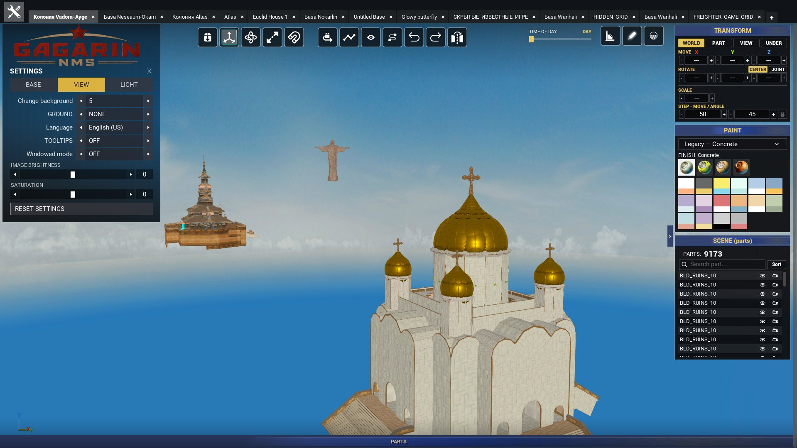
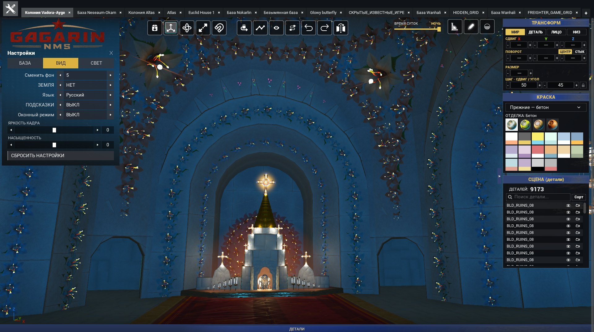
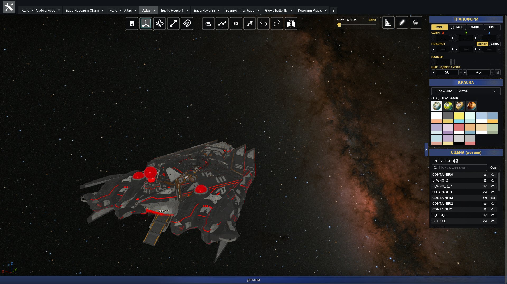
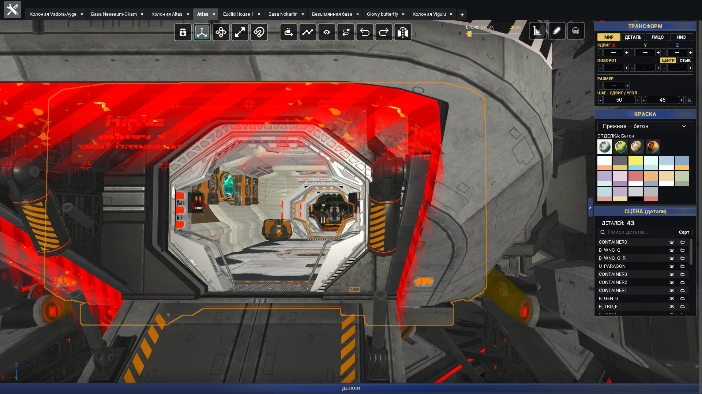
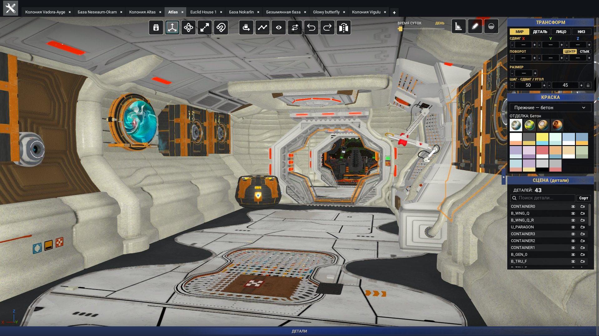
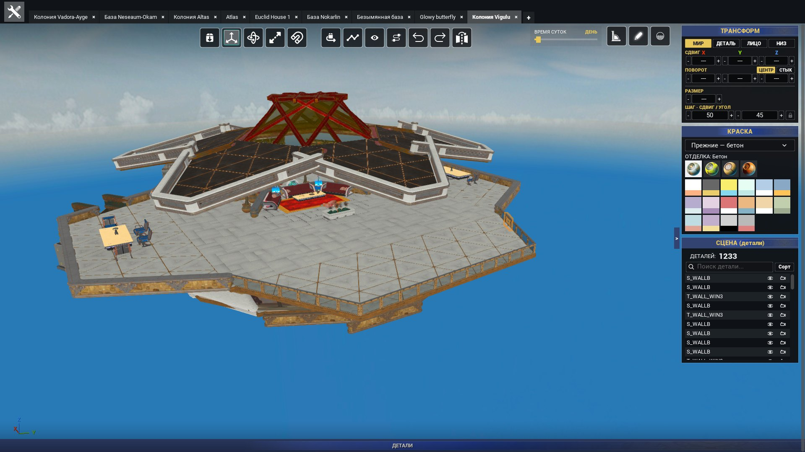
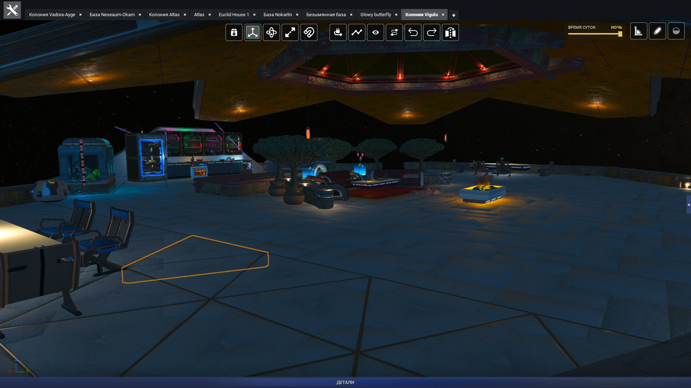
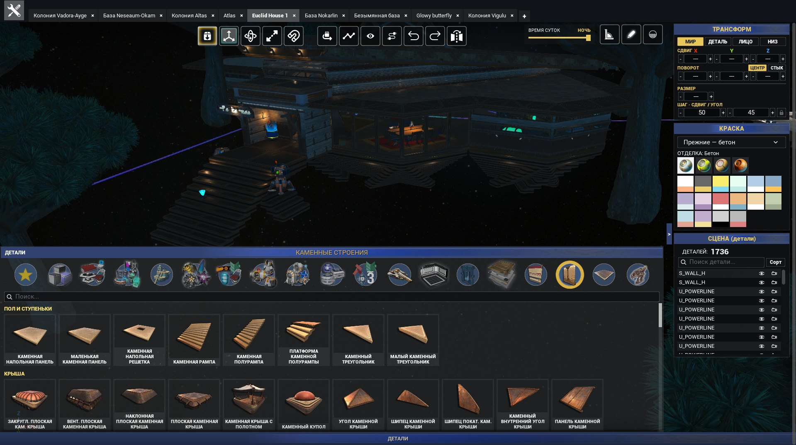
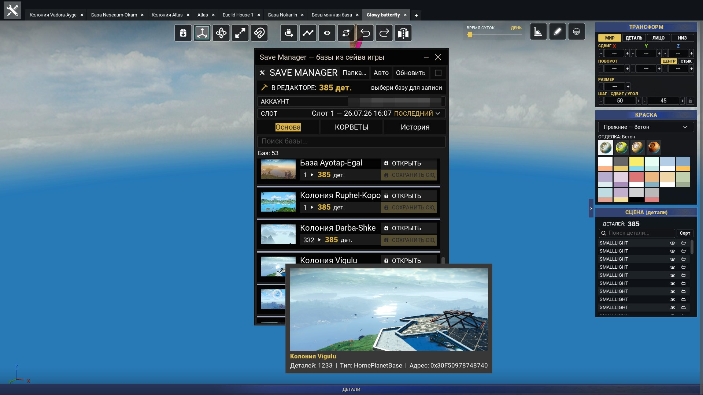

# GAGARIN NMS

A free base editor for **No Man's Sky**. Build a base in the app, then load it in the game.

Download the latest version from [Releases](../../releases).



## Screenshots

Everything below was built and captured in the app.

| | |
|---|---|
|  |  |
| Inside the same build | Corvette against the Milky Way |
|  |  |
| Corvette interior | Station interior |
|  |  |
| Living platform | The same base at night |
|  |  |
| Parts panel with 1,673 in-game parts | Bases read from the game save |

## Features

- **Parts catalog:** 1,673 in-game parts with their models, icons, and names in 17 languages, plus search, groups, and favourites.
- **Building tools:** snapping, move/rotate/scale controls, free placement, mirroring, curved placement, and reusable multi-part prefabs.
- **Painting:** in-game colours and finishes, with an eyedropper to copy paint from a placed part.
- **Save editing:** read bases from a No Man's Sky save and write them back.
- **Scene options:** panoramic backgrounds, ground coverings, time of day, lighting, and image settings.
- **Base tabs and session restore:** continue work after restarting the app; right-click tabs to rename bases or ships, with the name reflected in JSON export.
- **GLB model import:** retain separate material colours and base-colour textures across imported model sections.
- **Scale control:** scroll over the Scale number to adjust it with the mouse wheel.

## Install

1. Download `GAGARIN_NMS_v1.1.1.zip` from [Releases](../../releases).
2. Extract the archive with 7-Zip or Windows File Explorer.
3. Run `GAGARIN_NMS\\GAGARIN NMS.exe`.

There is no installer and the app does not write to the Windows registry. To uninstall it, delete the extracted folder.

**Requirements:** Windows 10 or 11 (64-bit), a DirectX 12 capable GPU, and about 1.2 GB of disk space for the archive plus extracted app, with additional space for imported-model caches and saved sessions.

### Automatic updates

Fork build **1.1.1** checks this repository for future releases. Automatic checks are enabled by default; saved update preferences are respected.

The mirrored v1.1.0 executable and original developer builds still check the original project's feed. Download and install **1.1.1 manually once** to switch to this fork. Later fork releases can be installed through the included updater.

### Windows warning on first launch

Windows may show “Windows protected your PC” because the app does not have a paid developer signature. Select **More info → Run anyway**. You can verify the download using the SHA-256 value in the release notes.

## No Man's Sky saves

The app can write a completed base directly to your game save. It blocks writes while the game is running, creates a dated backup before each write, and reads the file back to verify it afterward.

Please make your own copy of the save folder before your first edits.

Game saves are stored in:

```
%APPDATA%\\HelloGames\\NMS
```

The app's settings and tabs are stored in:

```
%LOCALAPPDATA%\\NMS_BuilderApp\\Saved
```

## Verify a download

The release notes include the SHA-256 checksum for the archive. In PowerShell, run:

```powershell
Get-FileHash 'GAGARIN_NMS_v1.1.1.zip' -Algorithm SHA256
```

The resulting hash must match the value in the release notes.

## Changelog

### [v1.1.1](https://github.com/ThePrecisionTechnician/Gagarin-NMS/releases/tag/v1.1.1)

- **Sharper rendering:** start at full rendering resolution, including when saved window settings already match.
- **Mouse-wheel scaling:** hover over the Scale number and scroll up or down to resize selected parts.
- **Rename tabs:** right-click a tab to rename a base or ship. Names persist across sessions and appear in exported JSON, with Undo/Redo support. Removed the unused search field from the tab menu.
- **Game JSON export:** consistent field order and four-space indentation, exact numeric GalacticAddress values, and preservation of unknown metadata and numeric precision.
- **GLB materials:** preserve separate base-colour textures and material colours through import, simplification, caching, and session restore. Also retain scalar roughness/metallic values and opaque double-sided material settings.
- **Automatic updates:** this build uses this fork's release feed. Update checks are enabled by default and respect saved preferences.

**Upgrading from the original app or v1.1.0?** Install v1.1.1 manually once to switch to this fork's update feed. Future fork releases can use the included updater.

### [v1.1.0](https://github.com/ThePrecisionTechnician/Gagarin-NMS/releases/tag/v1.1.0)

- Initial public mirror of the original developer's build. This executable retains the original project's update feed.

## Support

If something goes wrong, report what you did, what you expected, and what happened. Include your No Man's Sky version, GPU model, and the base file involved. Contact and support links are available in the app's main menu.

- Discord: [ThePrecisionTechnician](https://discord.com/users/262494560545013762)
- GitHub: [ThePrecisionTechnician](https://github.com/ThePrecisionTechnician)

**Support the project:** [Patreon](https://www.patreon.com/cw/ThePrecisionTechnician)

GAGARIN NMS was created by **autoeme** and was passed on and is now maintained by **ThePrecisionTechnician**. Part models, icons, and names belong to Hello Games; the app displays assets already present in your copy of the game.
